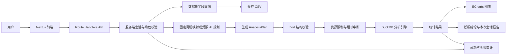

# AI 学生数据分析系统开发路线图

> 本地更新（2026-10-18）：AI 连续对话及图表工具能力见 [AI 图表能力扩展](docs/ai-chart-capabilities.md) 和 [开发续接记录](DEV_STATE.md)。下面的早期发布基线不代表当前本地能力，线上状态仍需单独验收。

> 目标赛事：传智杯 AI WEB 网页开发挑战赛（赛道 10037）
>
> 选择方向：AI 数据分析与可视化
>
> 最近更新：2026-10-13（测试环境增量发布与恢复回退验收）
>
> 省赛作品提交截止：2026-11-18

> 截止日期和交付格式沿用仓库原规划，尚需在提交前按官方公告核验。

## 0. 当前状态与下一步

当前已完成基础分析工作台、账号权限、AI 配置、查询保护、失败审计和当前结果导出，并于 2026-10-13 更新 VPS 测试环境。最新验收为 **194 条单元/路由测试、19 条认证 HTTP 测试、15 条运维 CLI 测试及类型检查通过**；复用已验证的构建镜像，完成候选、公网、重启持久化和独立恢复回退验收。详细记录见 [PROGRESS.md](PROGRESS.md)。本节是当前能力基准，后文未完成项属于后续计划。

| 能力 | 当前状态 | 验收或使用边界 |
| --- | --- | --- |
| 核心统计与图表 | 已完成 | 平均成绩、活跃次数、完成率；课程/学期分组；柱状图、折线图、表格；10 个固定问题不依赖模型密钥 |
| 数据概览与浏览 | 已完成 | 字段质量画像、概览摘要卡、当前结果搜索/排序和图表切换；每组至少 3 人，分析最多 100 个分组 |
| 账号与权限 | 已完成 | 登录会话、管理员/分析用户、账号创建/停用和改密；课程/学期数据范围权限仍待实现 |
| AI 自由提问与管理 | 链路已实现，真实服务待验收 | 受限结构化计划、澄清、配置加密保存、连接测试、预算及持久化费用估算；当前仅接入 OpenAI Responses |
| 查询保护与失败审计 | 已部署并回归 | DuckDB 管理内存上限、行列校验、真实超时/取消和中断竞争回归；两个接口的失败审计、真实上下文和用户归属已在候选/线上核对 |
| 当前结果与会话报告导出 | 已部署，本地下载已验证 | CSV、HTML 下载与报告预览；本次会话最多 20 种分析；线上浏览器下载及实际保存 PDF 尚未验收 |
| 数据与指标版本 | 部分完成 | 定义文件与记录字段已有；记录版本仍固定为 `1.0`，动态版本管理和结果返回版本未实现 |
| VPS 测试部署与恢复 | 增量发布及隔离恢复回退已验收 | 候选 70 项、公网 52 项检查及服务器审计核对；全记录重启哈希一致、原 42 条记录保留；独立卷恢复与旧版回退实测，线上仍为模拟数据、自签名证书 |
| 数据导入、服务器历史报告与分享 | 未实现 | 界面保留规划入口；分析记录目前是执行摘要，不能直接恢复历史完整报告 |
| 高级图表、异常检测与连续追问 | 未实现 | 概览卡不等于独立 KPI 类型；历史变化量、分组柱状图、面积图、选中联动和流式步骤仍待实现 |

下一步按以下顺序推进，每项完成后再评估是否扩展功能：

1. **收尾浏览器验收**：当前增量已部署，账号权限、核心统计、失败响应、审计和持久化回归通过；可信 HTTPS 就绪后补齐线上导出与实际 PDF 保存。
2. **正式演示环境验收**：真实 AI 连接与账单/预算核对、完整 OULAD 云端运行、可信 HTTPS；区分无模型固定问题与真实模型问题的验收结果。
3. **运行与备用环境验收**：VPS 已有 768 MiB 进程总内存限制，备份、恢复与镜像回退工具已纳入仓库并在独立实例实测；继续完善通用 Compose 资源配置，测量并发、长时间运行和 P95，演练备用主机。
4. **交付准备**：核验赛事要求，准备演示视频、技术 PDF、费用报告和公开仓库检查。
5. **按剩余时间选做扩展**：先考虑课程/学期筛选、分析历史和标准 CSV 导入；高级图表、异常检测、连续追问、细粒度权限及多服务商不影响前四项的交付进度。

## 1. 已确认的产品方向

### 1.1 产品定位

构建一个面向高校教学管理的 **AI 学生学习数据分析助手**。目前已跑通模拟 CSV 或本地 OULAD → 固定问题/受限自然语言计划 → DuckDB 确定性计算 → 图表、可追溯结论和会话报告。自由提问的真实模型服务待验收，用户上传和更多数据源仍属于后续扩展。

产品不做成只有聊天框的通用 BI 工具，核心流程必须是：

```text
自然语言问题
  → 识别指标、维度和可选筛选条件
  → 生成结构化分析计划
  → 校验字段与计算口径
  → 使用 DuckDB / SQL 实际计算
  → 生成图表
  → 输出可追溯的结论和报告
```

### 1.2 MVP 边界与主要分析场景

MVP 只承诺 3 个指标（平均成绩、活跃次数、完成率）、2 个维度（课程、学期）和 3 种展示方式（折线图、柱状图、表格），首批 10 个固定问题必须稳定通过。热力图、异常检测、个体风险和预测模型不属于首个垂直切片。

- P0：基础统计、图表、账号权限和工程保护已实现，继续完成正式演示环境与交付验收；
- P1：当前结果导出已实现；按时间与交付余量增加筛选、历史报告、标准 CSV 导入和更丰富的群体展示；
- P2：赛后再评估成绩与行为关系、退课/中断趋势、预测模型和更复杂的归因分析。

系统只输出满足最小样本阈值的群体统计和趋势，不公开单个学生排名，不生成个体风险名单，也不自动替教师作出高影响决定。

### 1.2.1 图表表现升级路线

图表升级遵循“先保证读数准确，再增加视觉表现和交互”的顺序。大语言模型只从白名单中推荐图表类型，具体颜色、布局、坐标轴、提示框和动画由系统模板控制，不能让模型直接生成任意 ECharts 配置。

| 阶段 | 图表/组件 | 适用问题 | 数据要求与实现边界 |
| --- | --- | --- | --- |
| P0 | 柱状图 | 比较不同课程或学期的单项指标 | 当前 `dimension + value + sampleSize` 即可；必须显示单位、样本数、排序和空结果状态 |
| P0 | 折线图 | 查看学期或时间顺序上的变化 | 需要有序分组；暂不表达因果关系，不用平滑曲线掩盖真实波动 |
| P0 | 数据表格 | 核对具体数值、指标口径和样本数 | 支持排序、单位和数值精度；作为所有图表的可核对出口 |
| P1 | KPI 指标卡 | 展示平均成绩、完成率、总活跃次数等摘要 | 概览统计卡已有；独立 KPI 分析类型、跨期变化值与可靠对比基准仍未实现 |
| P1 | 分组柱状图 | 同时比较多个指标或多个时间段 | 结果需要返回 `series` 和统一单位；不同量纲不能直接放在同一坐标轴 |
| P1 | 面积图 | 强调活跃度随时间的总量变化 | 需要时间序列；面积只用于总量或单序列，避免堆叠造成误读 |
| P2 | 热力图 | 查看课程×学期、课程×周次等二维模式 | 当前可返回课程/学期扁平组合分组；热力图仍需单独定义矩阵结果与缺失单元格语义 |
| P2 | 散点图 | 探索活跃次数与成绩等两个数值变量的关系 | 需要聚合后的点集和样本量；只描述相关性，不下因果结论 |
| P2 | 箱线图 | 查看不同课程的成绩分布和离散程度 | 需要分位数、四分位距和异常值规则，不能只用平均值生成 |
| P2 | 雷达图/桑基图 | 多指标概览或学习流程展示 | 仅在指标可比、流程数据完整时使用；不作为默认图表 |

统一视觉要求：响应式布局、有限且有语义的配色、清晰的图例和单位、悬停详情、加载/空数据/错误状态、键盘可访问的表格替代视图，以及不过度的动画。图表标题必须说明指标和分组维度，不能只显示“分析结果”。

### 1.3 适合比赛的差异化能力

建议把“分析可追溯”和“指标口径清晰”作为核心特色：

- 回答显示使用了哪些数据源和统计周期；
- 展示指标定义和计算公式；
- 展示生成并执行的只读查询；
- 发现问题口径不清时先追问，而不是直接猜一个数字；
- 对“相关关系”与“因果关系”明确区分。

演示重点是受控 AI 工作流、确定性计算、分析溯源和用户体验。指标库检索增强仍待实现，其质量指标应在实现后单独验证。

### 1.4 参考案例复盘后的冻结决策

已经对照学习分析和 GenBI 开源项目复核方案，吸收的是设计原则，不引入这些项目作为运行时依赖：

| 案例启发 | 本项目的落地决策 |
| --- | --- |
| Learning Trace Platform 的教师/学生双视角 | 首期只做教学管理者的群体分析视图；建议必须来自真实聚合结果，不做个体画像 |
| Open edX Engagement Analytics 的日志 → ETL → 数据集市 | OULAD 先整理成逻辑维表/事实表和 DuckDB 查询视图；不在截止日前引入 ClickHouse |
| Moodle Learning Analytics 的隐私和能力控制 | 最小样本阈值、只读分析、审计与基础角色权限已实现；上传和细粒度数据范围权限继续按实际需要扩展 |
| 紫金学院的自然语言意图识别 | AI 只负责识别指标、维度和澄清问题，不提供增删改工具，不让模型直接访问数据库 |
| WrenAI 的语义层和可审查上下文 | 将指标定义、别名、粒度、公式和示例作为版本化 YAML/Markdown 资产，先实现轻量检索，不引入完整 GenBI 平台 |

这些决策构成提交版本的产品边界：**可复现的群体学习分析 + 版本化指标语义 + 受控计划 + 确定性计算 + 可追溯结果**。

## 2. 数据方案与合规边界

### 2.1 数据源优先级

| 优先级 | 数据源 | 用途 | 处理要求 |
| --- | --- | --- | --- |
| P0 | [OULAD](https://archive.ics.uci.edu/dataset/349/open+university+learning+analytics+dataset) | 主数据源，学习行为、成绩、注册和退课分析 | 使用数据页当前许可，README 中保留来源和引用；不尝试重新识别学生 |
| P0 | 本地 `oulad_raw/` | 当前开发数据；完整云端运行待验收 | 本地已有 OULAD CSV，字段画像可用；可复现的小型子集和云端完整数据验收仍需固化 |
| P1 | [UCI Student Performance](https://archive.ics.uci.edu/dataset/320/student+performance) | 成绩影响因素和预测补充场景 | 按数据页条款引用，核对当前许可 |
| P0 | 自建模拟校园数据 | 演示、测试和公开仓库 | 使用虚构学生编号，不对应真实人员 |
| P2 | 学校真实脱敏数据 | 提升本土场景真实性 | 必须取得学校授权，不能直接放入公开仓库 |

本地开发目录可放置以下数据资产（CSV 已被 `.gitignore` 排除，不提交到公开仓库）：

- `oulad_raw/assessments.csv`
- `oulad_raw/studentRegistration.csv`
- `oulad_raw/vle.csv`
- `oulad_raw/courses.csv`
- `oulad_raw/studentVle.csv`
- `oulad_raw/studentInfo.csv`
- `oulad_raw/studentAssessment.csv`

### 2.2 建议的数据模型

把 OULAD 统一为分析友好的数据层：

| 表 | 主要内容 |
| --- | --- |
| `dim_student` | 匿名学生编号、非识别属性 |
| `dim_course` | 课程和开课期 |
| `dim_assessment` | 作业、考试、截止日期和权重 |
| `fact_activity` | 学习资源访问和点击行为 |
| `fact_assessment` | 成绩和提交时间 |
| `fact_registration` | 选课、注册和退课信息 |
| `dim_date` | 日期、周次、学期 |

当前版本使用受控 CSV 加 DuckDB 固定查询模板，尚未建设完整的 `dim_*`、`fact_*` 数据集市或 Parquet 导入链路。基础多用户能力通过文件持久化实现；更高并发、长期任务和在线上传需要扩大存储能力时，再评估 PostgreSQL、对象存储或 ClickHouse。

### 2.3 指标语义层与分析记录

指标定义已保存在 `docs/metric-definitions.yml`、`data/schema/` 和代码常量中。目标是登记稳定 ID、中文名称、别名、公式、输入表、粒度、时间语义、允许维度、样本阈值、单位和金标准查询编号，并统一实际使用的版本来源。当前分析记录的指标/数据集版本固定为 `1.0`，版本尚未随结果返回，仍需补齐。

两个分析接口已保存成功、空结果和失败记录，包括用户归属、接口来源、阶段、已验证的数据源/指标/计划、结果摘要、耗时和错误码。无法确认的上下文记为空；不保存原始个人行、原始提问或上游异常详情。当前记录不含完整结果快照、数据文件快照或持久化模型来源；严格历史复现、完整报告恢复和分析记录浏览仍需增加相应版本与存储设计。

### 2.4 数据粒度与指标金标准

- `fact_activity` 的粒度是“学生-课程-开课期-日期-资源”，复合键为 `id_student + code_module + code_presentation + date + id_site`；
- `fact_assessment` 的粒度是“学生-课程-开课期-考核项”，复合键为 `id_student + id_assessment`，连接考核项时必须同时校验课程和开课期；
- `fact_registration` 的粒度是“学生-课程-开课期-注册事件”，退课日期为空表示未退课；
- 每个指标都要有金标准 SQL、连接键、去重规则、时间语义和成绩归一化说明，禁止直接跨事实表连接后再聚合。

### 2.5 合规规则

- 成绩、学号、联系方式、学习轨迹等属于个人信息，应按最小必要原则处理；
- 未经授权不得接入真实教务系统或公开真实学生记录；
- 真实数据只保留匿名 ID，按数据集使用独立盐值哈希；
- 原始文件、密钥和个人信息不得提交到 GitHub/Gitee；
- 发送给模型的内容优先是字段结构、聚合结果和必要样本，不发送不必要的逐行个人记录；
- 数据集中的文本内容视为不可信数据，不能把单元格里的指令当作系统指令执行。

## 3. 适合 AI 全程编码的系统架构

采用 **AI 友好的模块化单体**，不在第一版拆分微服务。这样代码上下文集中、接口数量少，AI 更容易生成和维护。



### 3.1 当前技术栈

提交版本固定为 Docker Compose + Node.js 服务 + DuckDB + 持久化卷，保证原生依赖、文件和长查询行为可复现。Vercel、Supabase、MinIO、ClickHouse 只记录为赛后演进方向，不进入截止日前的主链路。

| 层 | 选型 | 目的 |
| --- | --- | --- |
| 前端与 API | Next.js 16.3.5、React 19.2、TypeScript | 页面与 Route Handlers 统一在一个应用中；流式步骤尚未实现 |
| UI | React 组件与 `app/globals.css` | 当前使用自定义 CSS 工作台，未引入 Tailwind/shadcn/ui |
| 图表 | ECharts 6 | 柱状图、折线图与响应式展示；表格作为核对出口，高级图表仍待扩展 |
| 账号、配置与费用 | JSON 状态文件 | 服务端会话、角色权限、加密配置、原子写入和跨进程锁 |
| 分析记录 | JSONL 文件 | 保存已验证计划、固定版本字段、执行摘要和审计上下文 |
| 文件存储 | 本地受控目录和 Docker 持久化卷 | 当前分析 CSV；用户上传与其他格式尚未开放 |
| 分析引擎 | `@duckdb/node-api` | 受控查询模板、确定性聚合与原生查询中断 |
| AI 接入 | OpenAI SDK 7 / Responses 结构化输出 | 生成受限字段并校验；真实服务商调用待验收，多服务商未实现 |
| 输出校验 | Zod 4 | 校验输入和分析计划；图表由应用模板生成 |
| 结果导出 | 浏览器 Blob 与受控 HTML 模板 | CSV 下载、会话报告预览/HTML 下载及浏览器打印 |
| 包管理 | pnpm | 统一脚本、依赖和构建流程 |
| 部署 | Docker Compose | 作为唯一提交部署方式，确保 DuckDB 原生依赖可用 |

### 3.2 当前目录结构

```text
student-analytics/
├── app/                  # 页面、布局和 API Route Handlers
├── components/           # 工作台、登录、管理、图表和会话报告
├── lib/
│   ├── analysis/         # DuckDB 查询、统计和结果校验
│   ├── ai/               # Prompt、固定问题和受限模型规划
│   ├── auth/             # 账号、会话和 API 权限
│   ├── settings/         # AI 配置与文件状态存储
│   ├── records/          # 分析审计记录
│   ├── exports/          # CSV 与 HTML 报告
│   └── security/         # 预算、限流与受限查询执行
├── data/
│   ├── sample/            # 虚构模拟校园数据
│   └── schema/            # 数据字典和指标口径
├── oulad_raw/             # 本地 OULAD CSV；完整数据不提交
├── records/               # 分析 JSONL 与系统状态，Git 忽略
├── docs/                  # 设计、评测和部署文档
└── package.json
```

### 3.3 AI 分析链路

模型不得直接执行任意 SQL，也不得直接凭语言模型计算数字。当前链路是“问题 → 固定问题映射或基于内置指标说明的 AI 规划 → `AnalysisPlan` → 固定查询模板 → DuckDB”，指标库检索增强仍待实现。已有字段/操作符白名单、登录与角色校验、限流、模型预算、DuckDB 管理内存限制、行列校验和超时/取消中断；部署层进程总内存、并发及细粒度数据范围权限仍需补充。用户上传实现时再增加相应文件校验。

下列名称描述工作流职责，并非全部已注册为独立 AI 工具。现阶段模型只输出结构化规划字段，统计解释和报告由应用根据真实结果生成。

1. `profile_dataset`：识别字段、类型、缺失值和数据范围；
2. `retrieve_metric_definition`（待实现）：检索指标定义、别名和计算口径；当前规划器使用内置指标说明；
3. `build_analysis_plan`：输出结构化 `AnalysisPlan`；
4. `validate_plan`：检查字段、指标、筛选条件和权限；
5. `run_analysis`：根据已校验计划选择固定 SQL 模板，由 DuckDB 执行；
6. `create_chart`：生成 ECharts 配置；
7. `generate_report`：只根据真实计算结果生成解释和报告；
8. `detect_anomaly`（P1）：只对聚合结果做群体层面的异常检测。

建议的核心类型：

```ts
type AnalysisPlan = {
  version: 1;
  datasetId: "demo" | "oulad";
  metric: "score" | "activity" | "completion_rate";
  aggregation: "avg" | "sum" | "count_distinct" | "rate";
  dimensions: ("course" | "term")[];
  filters: Array<
    | { field: "course" | "term"; op: "eq"; value: string }
    | { field: "course" | "term"; op: "in"; value: string[] }
  >;
  sort: { by: "value" | "dimension"; direction: "asc" | "desc" };
  limit: number; // 1–100
  chartType: "line" | "bar" | "table";
};
```

## 4. 功能范围与优先级

### P0：省赛必须完成

P0 的最小垂直切片是“模拟 CSV/OULAD 子集 → 10 个固定问题 → AnalysisPlan → DuckDB → 图表 → 来源、口径、SQL 和统计周期”。上传、Excel、热力图和异常检测必须在垂直切片稳定后再加入。

- [x] 预置模拟 CSV、受控本地 OULAD 和数据集选择；
- [x] 自动字段识别、缺失值和数据质量概览；
- [x] 10 个固定问题与受限自然语言规划链路；
- [x] 指标定义、粒度、公式与阈值；
- [ ] 统一动态指标/数据集版本来源并随结果返回；
- [x] 结构化分析计划、白名单校验和 DuckDB 实际统计；
- [x] 折线图、柱状图、表格、响应式工作台、结果解释与 SQL 溯源；
- [x] 分析记录：真实上下文、用户归属、已验证计划、结果摘要和错误码；
- [x] 登录会话、基础角色、账号管理与 AI 配置；
- [x] 失败提示、空结果、原生超时/取消、管理内存和结果行列限制；
- [x] 模拟数据的本地及当前增量 VPS 演示、部署回归与独立恢复回退；
- [ ] 完整 OULAD 云端运行、可信 HTTPS、真实 AI 和正式演示环境验收。

### P1：完成 P0 后加入

- [x] 当前结果 CSV 下载、会话报告预览与 HTML 下载；
- [x] 浏览器打印/另存 PDF 入口；实际保存 PDF 仍待验收；
- [x] 概览统计摘要卡、图表悬停详情和表格替代视图；
- [ ] 课程/学期筛选界面（计划与 SQL 已支持 `eq`/`in`；当前搜索仅筛选已返回结果）；
- [ ] 持久化分析历史和服务器报告恢复，补充聚合结果快照、版本及用户访问控制；
- [ ] 标准 CSV 模板导入、字段映射和校验预览，再评估 Excel 与数据集版本管理；
- [ ] 时间范围分析（需要扩展当前仅课程/学期的筛选 schema）；
- [ ] 指标口径库的检索增强与口径澄清选项卡；
- [ ] 独立 KPI 分析类型、可靠历史变化量、分组柱状图、面积图和图表/表格选中联动；
- [ ] 群体异常检测、连续追问、流式分析步骤；
- [ ] 报告分享、Markdown 或服务端直接 PDF 导出，按交付时间选做。

### P2：有余力再做

- 报表截图识别；
- 语音提问；
- 主动洞察卡片；
- 分析路径保存和回放；
- 热力图、散点图、箱线图以及多图联动仪表盘；
- 群体层面的预测研究或更复杂的归因分析，需独立设计与验证；
- MCP Server 封装数据库工具。

不要在 P0 稳定前加入多 Agent、复杂 MCP 或多个模型供应商。比赛作品首先需要可运行、可解释、可复现。

## 5. AI 编码工作方式

“All in AI code”仍然需要人工先确定边界。推荐按以下顺序执行：

1. 先写数据库表结构、`AnalysisPlan`、工具输入输出和错误格式；
2. 让 AI 先生成数据导入、字段分析和 DuckDB 查询模块；
3. 为分析模块准备固定样例输入、预期结果和失败用例；
4. 再生成 API、页面和图表组件；
5. 最后接入模型、Prompt、Function Calling 和流式 UI；
6. 每批可验证改动完成后检查差异、同步进度并提交 Git；当前新增能力仍保存在本地工作区，尚未提交和部署；
7. 所有模型输出都经过 Zod 校验、权限校验和结果校验；
8. 不接受 AI 生成的任意代码执行、任意 SQL 或未经解释的预测结论。

建议在仓库中维护以下文档，作为 AI 编码上下文：

- `docs/architecture.md`：架构和数据流；
- `docs/data-dictionary.md`：字段含义和允许的分析维度；
- `docs/metric-definitions.yml`：指标口径；
- `docs/ai-tools.md`：工具参数、返回值和错误处理；
- `docs/demo-questions.md`：经过验证的演示问题和期望结果。

## 6. 开发时间表

按仓库记录的 2026-11-18 截止倒排，保留 11/15–11/18 缓冲。原第 1–5 周中的基础开发与工程保护已提前完成；下表按 2026-10-13 的实际状态分配剩余工作，状态不代表全部任务在原计划日期内完成。

| 阶段 | 时间 | 当前状态与主要任务 | 退出标准 |
| --- | --- | --- | --- |
| 基础开发 | 9/20–10/10 原计划 | 初始化、模拟数据、固定查询、AnalysisPlan、三种展示和核心回归已完成 | 固定问题闭环与基准结果已验证；动态版本仍单列待办 |
| 当前增量交付 | 10/12–10/17 | 查询保护、失败审计和导出已部署，持久化及独立恢复回退通过；补齐线上下载与打印 PDF，整理改动提交 | 原账号/记录保留；CSV、HTML、实际打印 PDF 均验收 |
| 正式环境与性能 | 10/18–10/24 | 真实 AI 与费用预算核对、云端 OULAD、可信 HTTPS、进程资源限制、并发/P95 和长时间运行 | 留存真实调用与资源/性能测量报告，明确固定问题和 AI 问题的不同耗时目标 |
| 备用演练与选做扩展 | 10/25–10/31 | 备份/恢复/回退工具及隔离实例实测已完成；演练备用主机，补版本返回；有余量再选筛选、历史或标准 CSV 导入 | 备用主机恢复通过；扩展必须独立验收，不扩大核心数据范围 |
| 交付材料初稿 | 11/1–11/7 | 核验赛事要求，整理技术文档、演示脚本、费用报告、演示账号和公开仓库 | 材料可完整走读；缺失项有负责人/完成日期，不再新增大功能 |
| 录制与最终回归 | 11/8–11/14 | 录制视频、定稿技术 PDF、固定案例/边界回归及部署复核 | 交付物就绪，评审账号与演示环境可用，无核心回归 |
| 缓冲期 | 11/15–11/18 | 最终检查、问题修复和省赛提交 | 仓库、视频、文档、链接和账号按官方要求核验 |

按可验证产物提交 Git：可运行用例、golden case、数据字典、查询模板或安全测试均可作为当天提交内容；不以提交次数作为质量指标。每周更新一次 README 或技术文档。

## 7. 验收与评测指标

### 7.1 功能验收

维护 `golden_cases`：每条记录包含问题、预期 AnalysisPlan、预期查询语义、结果容差、图表类型和失败场景。当前最近一次本地验收为 194 条单元/路由测试、19 条 HTTP 测试、类型检查及生产构建通过；普通 `pnpm test` 会跳过 HTTP，需单独运行 `pnpm test:api`。

- 已有 10 条 P0 正常问题与 B01–B11 边界基准，另有权限、安全、审计、真实查询中断和导出回归；
- 固定问题的计划、数值、顺序、样本数与基准一致；边界返回对应澄清或错误码；
- 真实模型计划字段准确率 ≥ 90%、SQL 执行成功率 ≥ 95%、数值误差 ≤ 1%、澄清触发准确率 ≥ 85% 是验收目标，尚未用真实服务商样本统计；
- 固定问题 P95 < 2 秒、单次模型成本及并发上限仍需专项测量；真实 AI 请求另列耗时与费用，不将查询超时上限当作性能达标；
- 对无字段、空结果、时间范围错误和权限不足给出明确反馈；
- 当前回答可查看数据源、口径、SQL、周期、样本和过滤说明；数据集/指标版本随结果返回仍待实现，分析记录中不保存原始个人行；
- 本地 CSV 和 HTML 下载已有实测；本轮复核完成率结果与报告入口后遇到浏览器工具访问限制，线上浏览器下载、实际 PDF 保存与新增页面窄屏检查仍待验收；
- 服务器历史报告、导入和分享未开放，不计入已完成的功能验收。

### 7.2 AI 质量验收

记录以下指标，而不是只展示“回答看起来不错”：

- 分析计划字段正确率；
- SQL 执行成功率；
- 统计结果与人工基准的差异；
- 图表类型选择正确率；
- 图表与数据结构匹配率；
- 图表在桌面和窄屏下的可读性、表格替代视图和空状态验收；
- 口径澄清触发准确率；
- 平均响应时间和单次模型成本。

AI 未配置时，10 条 P0 固定问题仍必须完整通过；模型质量指标只在配置模型后统计，不能成为本地演示的单点依赖。

### 7.3 评审材料验收

- 公开 GitHub/Gitee 仓库，包含完整提交历史；
- README 包含项目介绍、架构、安装运行、环境变量模板和团队信息；
- 5–8 分钟、1080p 以上 MP4 演示视频；
- 不超过 30 页的 PDF 技术文档；
- 可选的公网在线演示地址和评审账号；
- 公开仓库中不包含 API 密钥或真实学生个人信息。

## 8. 推荐演示流程

1. 使用已初始化的演示账号登录，选择模拟校园数据，展示字段质量和概览统计；OULAD 只在对应环境完成验收后使用；
2. 点击固定问题“比较各课程学习活跃次数。”，展示图表、表格和可追溯 SQL；
3. 点击“哪门课程完成率最高？”，展示群体统计、样本数与最小样本阈值；
4. 展开指标口径、统计周期和 SQL；下载 CSV，在报告中心预览并下载 HTML，打印 PDF 在实测后展示；
5. 展示已有基准中的空结果/非法请求及失败审计，说明明确错误码和真实上下文；
6. 真实 AI 验收后再展示非固定问题与澄清；未完成验收时保持固定问题演示；
7. 展示账号权限、AI 预算配置、Docker 运行和记录持久化。动态图表步骤、版本返回、上传、历史报告与分享在实现并验收后再加入脚本。

## 9. 主要风险与处理

| 风险 | 处理方式 |
| --- | --- |
| AI 生成错误 SQL | 只允许白名单字段和只读查询，执行前 Zod/SQL 校验 |
| 模型编造数字 | 结论只能读取 DuckDB 返回结果，禁止直接从模型文本取数字 |
| OULAD 数据量较大 | 先用子集开发；稳定后用 DuckDB 直接查询 CSV/Parquet |
| 公开学生数据合规风险 | 优先使用匿名公开数据和模拟数据，不使用真实个人记录 |
| 功能范围过大 | 严格按 P0→P1→P2 实施，P0 未完成不扩展功能 |
| 部署临近截止出问题 | 第 2 周末完成最小部署，第 7 周固化主/备用部署并演练空环境恢复 |
| 被认为是普通聊天 BI | 强化指标口径、分析溯源、结果校验和真实教育场景 |
| 路线图与实际能力不一致 | 每周以 `docs/demo-questions.md`、`AnalysisPlan` schema 和可运行测试为准，删除未实现的演示承诺 |
| 跨事实表连接造成重复统计 | 先按事实表粒度聚合，再通过维度键连接；每个指标必须有金标准 SQL 和重复行测试 |
| 参考项目许可证不清晰 | 未声明许可证的仓库只用于学习交互和架构，不复制代码；复用前记录许可证和来源 |

## 10. 基础设施与赛事核验

当前已有 Docker/Compose、环境模板、持久化账号/设置、应用会话就绪探针和 VPS 发布记录。完整 records 备份、清单验证、全新卷恢复与单服务镜像回退工具已纳入仓库；2026-10-13 在 VPS 独立恢复实例实际演练通过，证据见部署及恢复文档。独立健康检查、监控告警、日志脱敏和备用主机部署/恢复仍待完成。

赛事提交格式、视频时长、技术限制、评分项和截止时间以官方公告为准。仓库原规划的 5–8 分钟 1080p MP4、≤30 页技术 PDF 等要求尚需再次核验；提交前创建 `docs/competition-checklist.md`，记录官方链接、核验日期和各项完成状态。

## 11. 最终冻结方案

省赛提交版本按以下方案实施，不再在截止日前切换基础设施或扩大数据范围：

1. **数据**：模拟校园 CSV + 受控 OULAD；字段画像和缺失值已实现，可复现子集、云端完整数据及动态版本仍待固化。
2. **计算**：Next.js Route Handler 调用 DuckDB；事实表先按自身粒度聚合，SQL 由固定模板产生，模型永远不提交 SQL。
3. **AI**：固定问题走 golden case；其他问题只生成受限 `AnalysisPlan` 或澄清问题；AI 未配置时核心演示仍可运行。
4. **产品**：群体统计、三项指标、课程/学期维度、柱状图/折线图/表格、概览卡、指标口径、SQL 溯源、CSV 与会话 HTML 报告；基础角色权限已加入。独立 KPI、历史变化、高级图表和导入按余量选做；个体名单与高影响决策不进入提交范围。
5. **工程**：Docker Compose 是唯一提交部署方式；查询具有管理内存、行列、超时/取消保护，审计保存真实上下文与用户归属；进程资源、性能、恢复和回滚仍需正式环境验收。
6. **验收**：10 条正常 golden cases 与 B01–B11 边界基准通过；本地 `pnpm typecheck`、`pnpm test`、`pnpm test:api`、`pnpm build` 已通过，当前增量部署、空环境恢复、真实 AI 和实际打印 PDF 仍列为剩余验收项。

PostgreSQL、对象存储、ClickHouse、通用 Text-to-SQL、预测模型、个体风险、语音和 MCP 均作为赛后路线，不得挤占提交版本的稳定性工作。

## 12. 当前交付清单

### 已完成

- [x] Git 仓库、Next.js/React/TypeScript/pnpm 与自定义 CSS 工作台；
- [x] 模拟数据、本地 OULAD 接入与字段质量画像；
- [x] `AnalysisPlan`、固定查询模板、分析审计 schema；
- [x] 固定问题→DuckDB→图表/表格→口径与 SQL 溯源闭环；
- [x] 10 个 golden cases、B01–B11 边界及安全/认证回归；
- [x] 数据字典、指标定义与 AI 工具契约文档；
- [x] 受限自然语言规划、基础角色、账号管理与持久化 AI 配置/费用；
- [x] 查询资源保护、真实超时/取消及完整失败审计；
- [x] CSV 下载、会话 HTML 报告预览/下载及打印入口；
- [x] 本地 194 条单元/路由、19 条 HTTP 回归、类型检查和构建；
- [x] 旧版工作台 VPS 升级与持久化验收。

### 下一批必须验收

- [ ] 提交本地增量并部署 VPS，完成新版本回归；
- [ ] 实际打印/保存 PDF，复核新增报告页面窄屏布局；
- [ ] 真实 AI 连接与模型质量样本、费用/预算核对；
- [ ] 完整 OULAD 云端运行、可信 HTTPS 与可复现数据子集；
- [ ] 动态版本来源和版本随结果返回；
- [ ] 部署层进程资源限制、并发/P95 与连续 30 分钟演示；
- [ ] 备份/恢复/回滚脚本入库、主备恢复与实际回滚演练；
- [ ] 健康监控、日志脱敏验收、费用报告及覆盖率测量；
- [ ] 官方赛事核验清单、公开仓库检查、视频和技术 PDF。

### 按交付余量选做

- [ ] 课程/学期筛选、持久化分析历史和标准 CSV 导入；
- [ ] 独立 KPI 与历史变化量、分组柱状图、面积图和选中联动；
- [ ] 群体异常、连续追问、流式步骤、报告分享；
- [ ] Excel、多服务商和细粒度数据范围权限。
