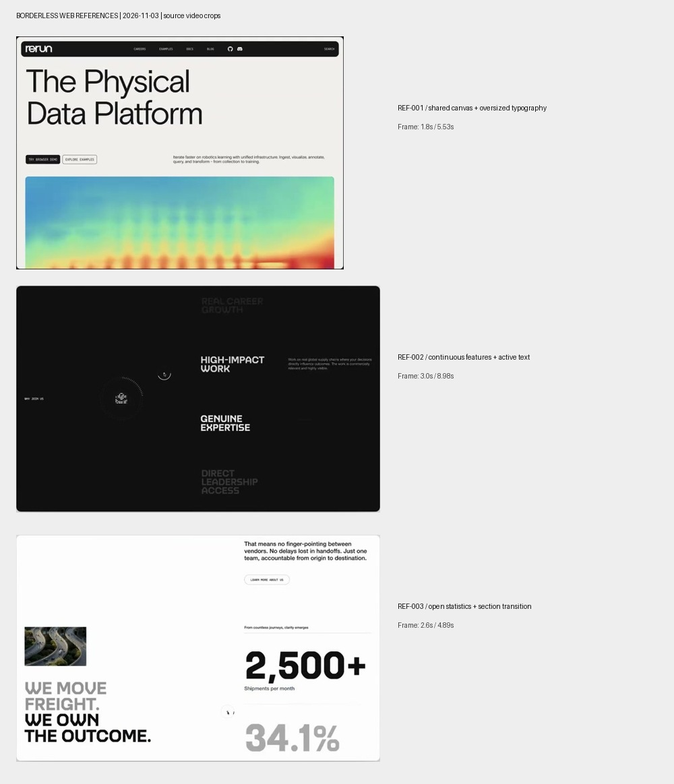
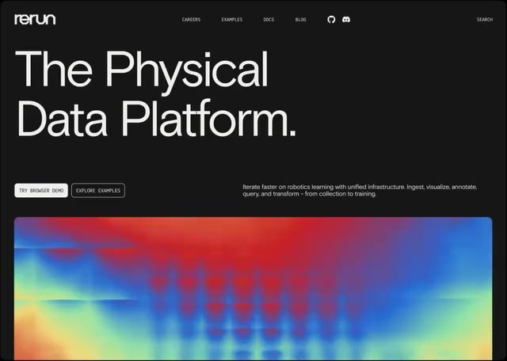
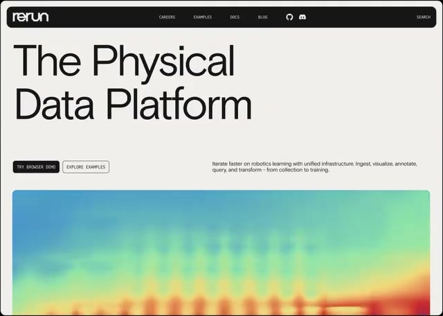
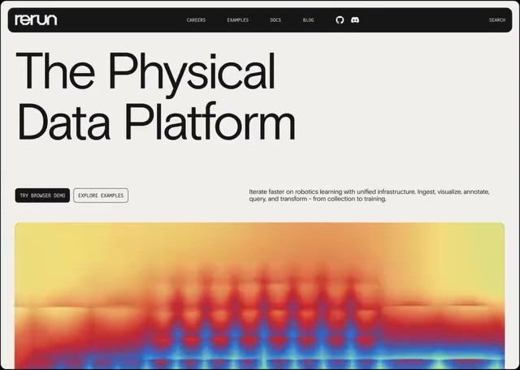
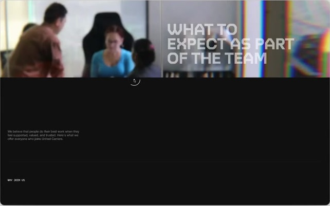
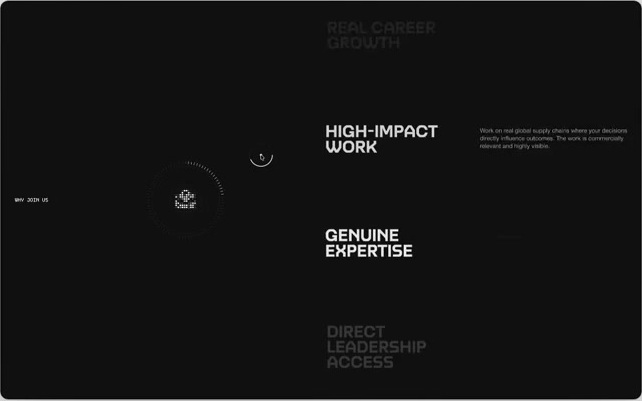
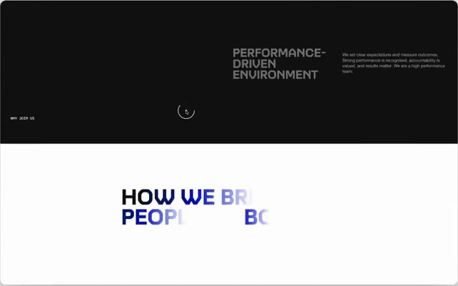
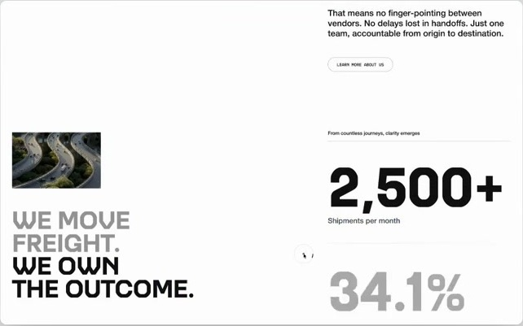
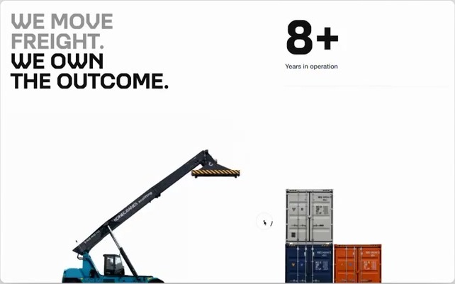

# 01 · 无边框网页：三个视频的图文拆解

记录日期：2026-11-03。编号：REF-001—REF-003。关联偏好：PREF-001。

## 1. 用户原意与本次结论

用户原话：

> 我很喜欢这几个视频中网页没有边框的设计感，你可以尝试截点图总结一下。

本次将这种感觉暂记为 **“弱边界的开放画布”**：内容共用大片背景，主要用排版、留白、对齐和滚动节奏建立结构，减少给每一组内容单独加卡片外壳的做法。这是对素材的分析用语，尚不是用户确认的风格名称。



**如何理解画面中的边框：** 三个视频都有演示包装。第二、三个视频的灰色背景、上方标志、下方宣传文字，以及中央窗口的圆角和投影，属于视频的展示层。本次重点分析窗口内部的网页。窗口内部也保留了少量按钮描边、细分隔线或圆角媒体，因此不能把用户偏好机械解释成“任何地方都不许有边界”。

## 2. 素材目录与证据范围

| 编号 | 内容标签 | 用户链接 | 本地原视频 | 时长 / 分辨率 |
| --- | --- | --- | --- | --- |
| REF-001 | Rerun 标识页面：大标题与彩色动态媒体 | [Pinterest 1](https://pin.it/2XASXqvAo) | [播放 / 下载](assets/borderless/ref-001.mp4) | 约 5.53 秒 / 720×900 |
| REF-002 | United Carriers 功能与团队内容滚动片段 | [Pinterest 2](https://pin.it/vBefOcTJc) | [播放 / 下载](assets/borderless/ref-002.mp4) | 约 8.98 秒 / 720×1080 |
| REF-003 | United Carriers 宣言与数字展示片段 | [Pinterest 3](https://pin.it/11DSREDnV) | [播放 / 下载](assets/borderless/ref-003.mp4) | 约 4.89 秒 / 720×1280 |

取得的是 Pinterest 公开页面关联的 MP4。已抽帧查看画面变化；未操作原网站，也未检查原站 DOM、CSS 或真实滚动输入。以下“固定、滚动、遮罩、计数”等首先描述画面表现，具体实现单列为建议。

图中的时间均为**该短视频内部时间**，不是原网站的时间或滚动百分比。正文配图从解码帧中裁去展示留白，保留网页窗口内容，没有补绘或修改网页。每个案例另保留一张未裁切帧，用于核对上下文。

来源的长链接、页面报告的规范链接、关联 Details 页面、媒体 URL、视频校验值、截帧时间和裁切坐标均见 [sources.json](assets/borderless/sources.json)。Pinterest 转存条目与规范链接的 Pin 编号可能不同，清单分别保留，不据此认定原作者。

## 3. REF-001：用排版和主视觉撑起首页

画面可见 Rerun 标识，以及两行大标题。页面在深色与浅色状态间变化，下方是一块持续变化的彩色媒体区域。[用户来源](https://pin.it/2XASXqvAo)

| 0.2 秒：深色状态 | 1.8 秒：浅色状态 | 3.2 秒：彩色媒体变化 |
| --- | --- | --- |
|  |  |  |

### 能直接观察到什么

- 标题直接放在页面底色上，占据很大的视觉面积，没有独立标题卡片。
- 标题、按钮、说明与媒体共享清楚的左右边距；分组依靠位置和间隔。
- 大标题与短说明的字号差别明显，画面同时保留大块空白。
- 动态色彩集中在下方媒体中；上方文字布局基本稳定。
- 顶部导航、按钮和媒体仍有自己的局部形状；整体的开放感主要来自页面主体。
- 深浅颜色变化形成明显的水平推进过程。仅凭片段不能确认它是用户触发的主题切换，还是演示动画。

### 可借鉴的做法

适合首页、章节开场、产品介绍：先确定一个主要标题，再让说明、操作和视觉内容围绕它排列。通过共享对齐线建立秩序，让最强的动态区域承担视觉焦点。

迁移到数据产品时，可把下方媒体替换为真实数据驱动的图形。这里的彩色图案只能确认视觉变化，不能据此证明它展示了实时业务数据。

实现建议：普通布局与统一间距变量即可建立基础；需要颜色揭示效果时，再尝试单层遮罩或背景过渡。视频不能证明原站使用了哪一种技术。

[查看横向时序图](assets/borderless/ref-001-sequence.jpg) · [查看未裁切原帧，1.8 秒](assets/borderless/ref-001-02-full.jpg)

## 4. REF-002：让一组内容在同一片空间中连续经过

片段从照片与标题进入深色内容区，一系列功能或团队特点依次经过画面中部，末段露出白色的下一章节。页面元数据将它关联到 United Carriers 的功能区参考。[用户来源](https://pin.it/vBefOcTJc) · [关联参考页](https://www.details.so/inspo/unitedcarriers-070979)

| 0.2 秒：照片与章节入口 | 3.0 秒：深色连续内容 | 8.3 秒：进入下一章节 |
| --- | --- | --- |
|  |  |  |

### 能直接观察到什么

- 小标签、图形、功能名称和说明形成横向对齐关系，没有逐项包进独立面板。
- 多个功能名称同时出现在画面中；不同位置的文字亮度不同，中部内容更突出。
- 功能项持续向上移动，保持上下文；左侧的小标签和图形区域相对稳定。
- 深色底贯穿整个功能序列，靠空间关系组织内容。
- 结尾通过大面积黑白底色变化进入下一节，章节边界明显，内部条目的边界较弱。

### 可借鉴的做法

适合步骤介绍、能力列表、课程或指标的连续阅读。保留前后条目的少量上下文，让当前内容更清楚，而不是每次彻底替换整屏。

迁移到数据浏览时，可以让用户选中的课程或指标处在主要阅读位置，附近项目仍可见。描述、图形和当前项同步变化，具体是否采用固定侧栏需结合实际页面验证。

实现建议：先建立可正常阅读的纵向结构，再尝试局部固定区域和随位置变化的强调。固定区域的范围、移动端高度、键盘访问与减少动态效果都应实际检查；不从视频直接推断原站的实现方式。

[查看横向时序图](assets/borderless/ref-002-sequence.jpg) · [查看未裁切原帧，3.0 秒](assets/borderless/ref-002-02-full.jpg)

## 5. REF-003：用大数字和留白组织指标

片段从深色、蓝色到白色的渐变区域进入浅色页面。左侧是小图和大字宣言，右侧是依次进入视野的大数字，尾部露出设备与集装箱图像。[用户来源](https://pin.it/11DSREDnV) · [关联参考页](https://www.details.so/inspo/unitedcarriers-9aa62e)

| 0.3 秒：渐变过渡 | 2.6 秒：宣言与主要数字 | 4.6 秒：进入场景图像 |
| --- | --- | --- |
|  |  |  |

### 能直接观察到什么

- 指标直接排列在统一的白色背景上，数值外没有各自独立的色块或厚重外壳。
- 数字明显大于单位和解释，字号建立了清晰层级。
- 左侧宣言和右侧指标使用不对称分栏，靠对齐与间距维持秩序。
- 数值在片段中发生变化，文字也经历强调变化；过渡帧中的灰字或不完整文字不能当作最终排版。
- 局部存在细线和微小标记；它们没有形成密集的卡片网格。
- 图像、宣言、指标和下一段场景属于连续页面，画面不是一串孤立面板。

### 可借鉴的做法

适合数据概览、成果展示和报告章节。让少数关键指标成为阅读焦点，使用单位、口径说明和共享对齐线维持可读性。

迁移到成绩分析时，可考虑主要指标与解释并排呈现，再自然进入分布图或课程关系图。具体指标应由真实数据与分析任务决定。原视频里的数字只属于来源画面，不能作为本项目数据。

实现建议：先把最终数值和说明正确展示，再添加可关闭的数值过渡。不要让动画中的中间数被误认为查询结果；渐变与图片主要承担章节衔接。

[查看横向时序图](assets/borderless/ref-003-sequence.jpg) · [查看未裁切原帧，2.6 秒](assets/borderless/ref-003-02-full.jpg)

## 6. 三个案例可以提炼出的设计方法

以下是本次分析建议，供后续任务选择，不代表用户已经要求全部采用。

| 方法 | 画面依据 | 可以怎样使用 |
| --- | --- | --- |
| 共用画布 | 三例的主体内容共享底色 | 先设计整页网格，再决定哪些内容确实需要独立容器 |
| 用排版建立层级 | REF-001 的大标题、REF-003 的大数字 | 拉开主次字号，限制同时争夺注意力的元素数量 |
| 用留白分组 | 标题、说明、指标之间留有明显空间 | 同组靠近，跨组拉开，避免只靠线条说明关系 |
| 用对齐连接内容 | 多列共享边距、基线或纵向阅读线 | 图表、标题、说明与操作采用一致的空间规则 |
| 保留连续上下文 | REF-002 的前后条目与章节切换 | 连续阅读时保留邻近内容，不强制拆成独立屏幕 |
| 控制动态焦点 | REF-001 媒体变化、REF-002 当前项强调 | 一段时间突出一个主要变化区域，保持其余内容稳定 |
| 边界按用途出现 | 局部按钮描边、指标细线、整节底色变化 | 在操作或章节需要时保留边界，内容主体减少重复外壳 |

“无边框”仍需要清楚的可操作状态。以后用于表单、编辑器或复杂数据表时，应分别判断输入边界、选中状态和焦点提示，不宜直接套用展示页的弱对比文字。

## 7. 可直接交给 AI 的提示词

```text
请先读取 docs/design/ai-frontend-reference/borderless-web.md，
并实际查看与本次任务相关的关键帧。

本次希望参考其中的无边框设计感：
让内容自然排布在统一画布上，减少给每块内容套独立卡片，
用字号、字重、留白、对齐和章节底色建立层级。

按具体用途选择参考：
- REF-001：页面开场、大标题、主视觉与说明的关系；
- REF-002：同一空间里的连续条目、当前项强调和章节衔接；
- REF-003：开放的指标排版、宣言与数字关系、图像衔接。

先依据当前内容做一个关键页面样例，再检查布局与交互。
数据展示使用真实查询结果或明确标注的演示数据。
需要保留输入、操作、选中和键盘焦点的可识别性。
深色主题、具体字体和全部动画是否采用，由本次任务另行决定。
完成后说明采用了哪个案例的哪些特征，并提供可查看的页面或截图。
```

## 8. 可沉淀为 Skill 的部分

当前先保留方法记录，尚未创建或安装 Skill。等流程在实际页面中验证后，可以把以下步骤整理成可复用工作流：

1. 读取当前页面的内容、布局约束和既有设计变量。
2. 检查重复容器是否有必要，建立统一的页面对齐关系。
3. 用排版与间距完成静态层级，再决定哪些变化需要动画。
4. 选择一个最能代表方向的页面做样例。
5. 查看桌面与窄屏，检查真实内容、长文本、空状态、交互和减少动态效果。
6. 将实际采用的规则、截图和适用限制回写到参考记录。

## 9. 已确认与待确认

- **已确认**：用户喜欢这三个视频中的“网页没有边框的设计感”，希望截图总结并保留为可读取的图文参考。
- **本次已完成**：下载三个来源视频；每例抽取三张代表帧并保存时间点；整理观察、共性、迁移建议和提示词。
- **分析建议**：将偏好理解为统一画布、弱化重复容器、依靠排版和空间组织内容。
- **待后续素材或用户说明补充**：最喜欢的具体片段；是否偏好黑白、大字或同款滚动；先应用于哪个页面。
- **应用状态**：尚未据此修改正式前端，也未验证原站实现；后续素材继续追加，不将这次分析视为全部风格要求。
