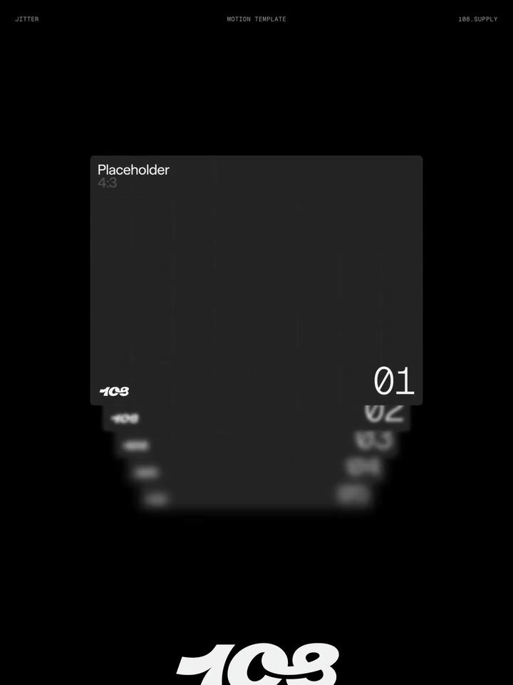
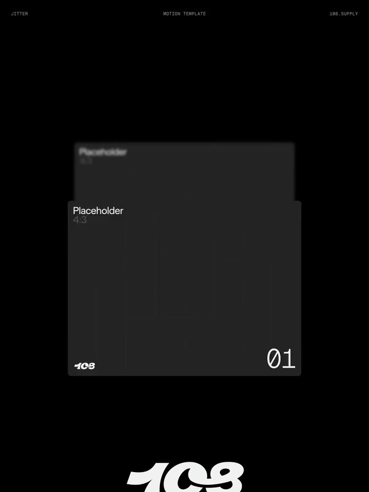

# 03 · 全站主要风格：边缘模糊

记录日期：2026-11-03。关联偏好：PREF-003。参考来源：REF-004 Descend Stack 视频。

全站颜色与材质已进一步明确为简洁黑白、光感玻璃、色散及少量主题色，统一读取[设计语言总纲](design-language.md)；本页细化边缘模糊。

## 1. 用户最新明确要求

> 视频动效主要还是那种边缘的模糊感，我想要整个网站的主要设计风格是有边缘模糊。

据此记录为：

- **主要借鉴点是边缘模糊。** 上一版对堆叠抽离、层叠递进的强调过重，现降为次要素材观察。
- **应用范围是整个网站。** 包括静态页面的视觉气质和动态过程，不只作用于数据浏览总览。
- **它是主要设计语言。** 后续布局、图表、交互和转场设计应主动考虑如何表现边缘虚化，而不是只在某个动画里临时添加模糊。
- **图片指定的总览视角仍保留。** 视角、模糊风格与具体运动轨迹分别记录，不相互替代。

这是当前风格讨论的优先依据。精确模糊范围、方向、强度与参数尚未确定。

## 2. 视频中的视觉参考

| 编号版，1.0秒 | 编号版，2.0秒 |
| --- | --- |
|  |  |

画面可见清晰的前层与逐渐虚化的边缘、后层文字共同建立空间感。这两张取样用于观察清晰度关系；用户提出的全站风格范围，来自本次明确说明，并非单凭视频推断。

[播放编号版原视频](assets/overview-stack/ref-004-placeholder.mp4) · [播放媒体版](assets/overview-stack/ref-004-media.mp4) · [来源链接](https://pin.it/74FDRvYo6)

## 3. 可执行的设计解读（建议，待样例细化）

**建议的共同特征：从清晰区域向边缘逐渐虚化，让内容之间存在柔和的过渡与空间层次。** 具体不要求所有元素使用相同强度或四边均匀模糊。

| 位置或状态 | 可尝试的应用方式 | 尚待选择 |
| --- | --- | --- |
| 页面与大幅内容的边缘 | 外围逐渐失焦，与背景柔和衔接 | 是视口外围、内容区边缘，还是两者组合 |
| 图表与视觉主体 | 用周边柔化或局部景深建立视觉焦点 | 作用于外轮廓、外围图元还是独立视觉层 |
| 总览的叠层页面 | 当前层较清楚，边缘与远层逐渐虚化 | 景深方向、前后衰减、选中后的清晰度 |
| 对话与长内容区域 | 在内容进入、离开阅读区域的位置形成柔和过渡 | 虚化区域宽度，以及与实际阅读位置的关系 |
| 菜单与操作浮层 | 让边缘和周围背景的过渡延续同一种质感 | 如何同时表达浮层层级、操作状态和焦点 |
| 页面切换与内容更新 | 聚焦、失焦过程延续静态边缘的视觉规则 | 是否与移动同步，旧新内容如何交接 |

以上是候选用法，不是用户逐项要求。特别是“边缘”究竟覆盖哪些位置，需要用图文或实际样例进一步收敛。

阅读区域、图表数值、按钮标签和键盘焦点保持清楚，是后续实现建议；边缘模糊仍是主风格，不因需要可读性就被缩减为只有背景或转场才出现的装饰。

## 4. 与已有方向的关系

- **无边框开放画布：** 延续统一背景、留白和对齐；边缘虚化补充柔和边界的质感。
- **总览斜侧视角：** 继续参考 REF-005 图片；边缘虚化可以帮助表达平面之间的距离。
- **模糊渐进转场：** 原先主要讨论页面切换，本次明确扩展为全站静态与动态视觉方向。
- **颜色与材质：** 用户随后明确黑白基础、光感玻璃与色散，允许少量主题色。具体高光、透明度、色散范围与主题色选择仍待细化。
- **堆叠动作：** 保留观察资料，实施优先级低于边缘模糊；不默认要求自动轮播或无限循环。

## 5. 后续参考提示词

```text
全站主要设计方向是边缘模糊，请先读取本文件并查看编号版视频关键帧。

将清晰区域向边缘渐进虚化的感觉贯穿页面静态风格和动态过程，
不要只在总览、切换动画或背景上临时加一层模糊就视为完成。
结合当前内容设计边缘的过渡范围、方向和清晰度层次。
主要阅读信息与交互状态需要清楚，具体应用方式先通过样例验证。

总览另参考 REF-005 的斜侧叠层视角。
视频中的堆叠移动是次要参考，不作为本轮首要目标。
配色遵循 design-language.md 的黑白基础、光感玻璃、色散和少量主题色。
角度、模糊强度、衰减范围、具体色值和光感参数尚未确认。
```

## 6. 状态与下一步依据

- **已确认：** 视频重点是边缘模糊；整个网站以它为主要设计风格。
- **仍有效：** 总览希望使用图片中的视角，无边框开放画布偏好仍保留。
- **待细化：** 具体边缘位置、静态和动态的强度关系、清晰区大小、移动端表现。
- **本次工作：** 修正参考文档与主设计说明；没有修改正式页面，也没有将候选应用标为已实现。
