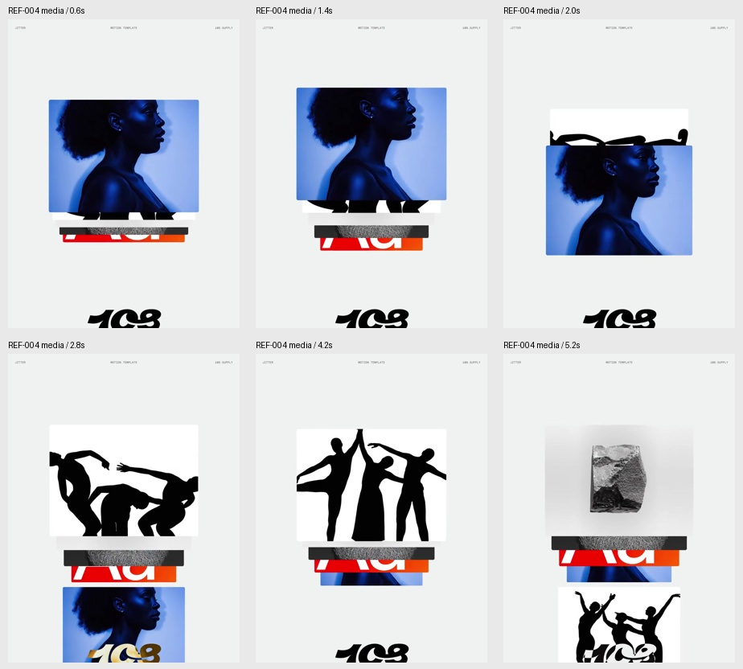
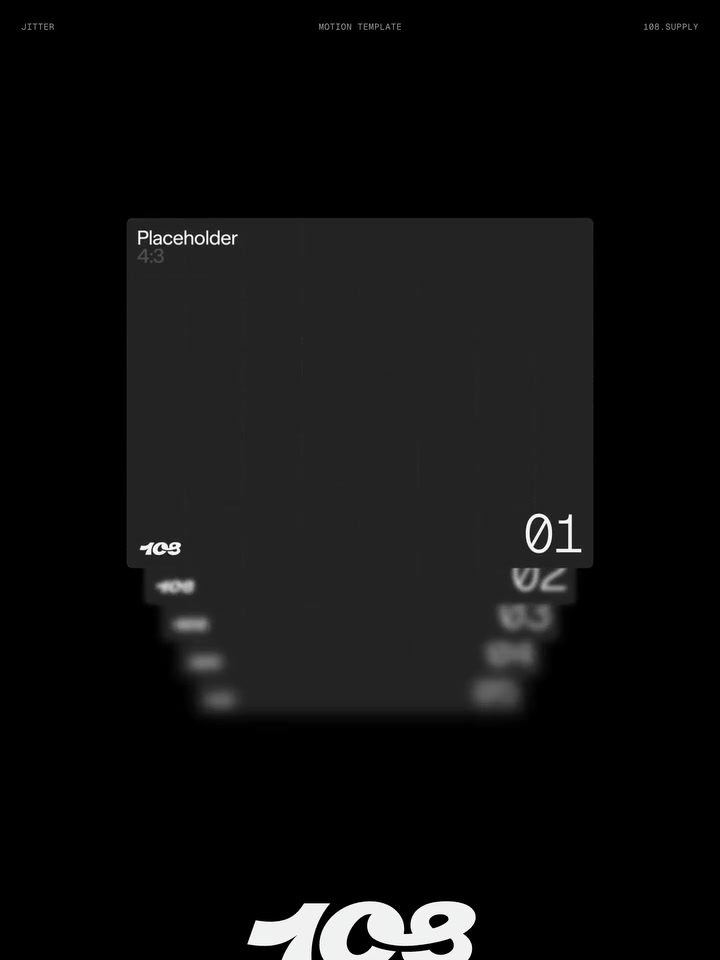
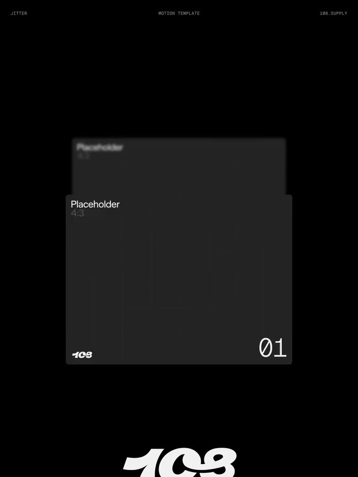

# 02 · 总览视角与边缘模糊参考

记录日期：2026-11-03。案例编号：REF-004、REF-005。关联偏好：PREF-002、PREF-003。

**最新说明优先：** 用户进一步明确，视频主要参考“边缘的模糊感”，并希望它成为整个网站的主要设计风格。下文运动时序保留为素材观察，堆叠移动不再作为主要诉求。全站要求见[边缘模糊风格说明](edge-blur.md)。

全站配色与材质已补充为黑白、光感玻璃、色散和少量主题色，后续先读[设计语言总纲](design-language.md)。本页对图片自身配色的保留意见，不影响用户已确定的全站方向。

## 1. 用户设想与两份素材的分工

用户表达：

> 这两个连接中图片的那张是我想实现的视角，视频是想实现的类似动效，在现在项目数据浏览中的总览页面中。

| 来源 | 实际素材 | 用户指定用途 | 本地资料 |
| --- | --- | --- | --- |
| [第一个链接](https://pin.it/74FDRvYo6) | Descend Stack；同一条目含编号占位版和媒体版两段视频 | 主要参考边缘模糊，作为全站风格；运动轨迹为次要参考 | [媒体版，约15.0秒](assets/overview-stack/ref-004-media.mp4) · [编号版，约15.7秒](assets/overview-stack/ref-004-placeholder.mp4) |
| [第二个链接](https://pin.it/33RrxhXoa) | 多张蓝黑卡片斜向叠排的静态图 | 希望实现的视角 | [原图，1024×768](assets/overview-stack/ref-005-perspective.png) |

**组合原则：图片负责总览的观察角度与空间排列，视频主要负责边缘逐渐虚化的质感。** 视频正面展示的角度不自动取代图片中的斜侧视角；其堆叠移动属于次要观察，不作为已明确的必做动作。

图片视角的应用场景已明确为**现有项目的数据浏览总览**。当前源码同时存在首页课程概览与左下“全览”打开的探索历史，因此图片视角暂以**探索全览**为落点，已请求确认具体入口。边缘模糊的应用范围则已扩大并明确为**全站**，不受总览入口是否确认的影响。

本次继续整理设计参考和实现意图，未修改正式页面。

## 2. REF-005：希望实现的空间视角


### 从图中可以直接观察到的特征

- **斜侧向、略带俯视。** 能看到较大的卡片正面，也能看到薄边，不是纯正面平铺。
- **卡面接近平行。** 多个平面沿一条斜向纵深连续排布，形成清楚的前后关系。
- **遮挡建立空间。** 前面的卡面挡住后面的一部分，后排仍露出顶部、侧边和局部内容。
- **局部卡面更突出。** 一些卡面在高度、露出面积和明度上与周围不同，使视线能找到重点。
- **主体超出画面。** 队列两端没有完整装进中心容器，带来画面之外仍有延续的感觉。
- 蓝黑色、亮边和紫色背景强化了这张图的视觉层次；这些属于素材自身风格。

### 用户已确定与尚未确定的部分

**已确定：** 希望借用这个观察视角。可作为后续全览构图的主要静态参照。

**尚未确定：** 精确角度、卡面尺寸、间距、选中页突出方式，以及是否采用蓝黑配色、紫底、亮边、相同圆角或信用卡比例。参考图没有给出可直接读取的相机参数，不记录臆测的精确角度。

### 迁移到数据浏览的候选表达

把卡片替换成已访问主题的页面缩略面，保留主题名与画法提示；前后层次表达探索过程，而不是分数高低或课程重要程度。当前选中的主题可增加露出面积，进入正式阅读后恢复清晰、可操作的正常页面。

这是一种迁移建议。原图本身没有定义历史顺序、点击行为或数据含义。

## 3. REF-004：素材中的层叠运动记录（次要参考）

本节描述视频发生了什么，不等于用户要求复刻这些动作。主要借鉴点是下方编号版中的边缘虚化与清晰度层次，具体见[专题03](edge-blur.md)。



六张图均来自本地媒体版视频，时间是片段内部时间。原帧未裁切、未补绘。上方是同一段运动的连续取样；完整节奏以[原视频](assets/overview-stack/ref-004-media.mp4)为准。

| 时间 | 画面表现 | 借鉴重点 |
| --- | --- | --- |
| [0.6秒](assets/overview-stack/ref-004-01.jpg) | 主图在前，后面露出数层图像边缘 | 前层清楚、后层仍能被感知 |
| [1.4秒](assets/overview-stack/ref-004-02.jpg) | 前层位置上移，与后层拉开 | 主层先与队列分离，形成动作准备 |
| [2.0秒](assets/overview-stack/ref-004-03.jpg) | 原主图向下经过，下一张图从后方显露 | 抽离、遮挡变化与下一层接替同时发生 |
| [2.8秒](assets/overview-stack/ref-004-04.jpg) | 下一张成为主图，原主图仍在下方退出 | 连续交接，避免直接换成完全无关的一帧 |
| [4.2秒](assets/overview-stack/ref-004-05.jpg) | 新的主图又开始下移，后方内容上升显露 | 同一动作规则可以重复使用 |
| [5.2秒](assets/overview-stack/ref-004-06.jpg) | 再下一张图占据前层，剩余图片继续叠在后面 | 队列中的元素始终有前后关系 |

### 运动结构的观察

1. 一张主层承担读取与视觉焦点，后层通过少量露出提示队列。
2. 主层经历位置变化和抽离，随后向下退出主要位置。
3. 后层逐级显露、补位，新的主层接替。
4. 前后层的相对尺度、位置与遮挡同步变化，形成纵深感。
5. 后半段能看到早先出现过的媒体再次回到前层，呈现循环观感。

这些是视频中的视觉表现。不能由片段断言真实网站使用滚轮、拖拽、自动播放或哪一种动画库。编号版可见边缘与后层文字的模糊衰减，这正是用户后续强调的主要参考。用户要求将边缘模糊扩展为全站风格，具体如何分配到页面边缘、内容轮廓或空间后层需继续设计。

| 编号版，1.0秒：叠层 | 编号版，2.0秒：前层退出 |
| --- | --- |
|  |  |

## 4. 两份参考如何组合

**当前表述：全站以边缘模糊建立视觉质感；总览额外采用图片给出的斜侧叠层视角。** 是否复用视频中的抽离、递进与接替动作属于后续选择，优先级低于边缘模糊。

| 维度 | 采用哪份参考 | 对项目的候选转译 |
| --- | --- | --- |
| 观察角度 | REF-005 静态图 | 以斜侧方观看平行的主题页面 |
| 前后关系 | 图片的空间排布 + 现有探索语义 | 一层对应一个已访问主题，顺序来自实际探索记录 |
| 主要视觉质感 | REF-004 视频 + 用户最新说明 | 边缘渐进虚化作为全站主要风格，不限于总览或转场 |
| 次要运动观察 | REF-004 视频 | 可研究抽离与补位，但不作为本次已确认的主效果 |
| 同主题的不同画法 | 项目既有要求 | 保留同一主题内的横向维度，不把每种画法混成新的历史主题 |
| 当前状态 | 图片局部突出 + 视频清晰度层次 | 通过清晰与虚化的差异组织焦点，具体范围待细化 |
| 全局形式 | 首批无边框偏好 | 空间层直接组织在整页画布上，避免外面再套多级模态卡片 |

**关于循环：** 视频用于表现视觉循环，真实探索历史有起止与顺序。实现时可以借鉴连续运动手感；是否允许首尾循环尚未指定，不能默认把最后一个主题接回第一个，也不能让用户误读浏览顺序。

## 5. 与当前源码的对应关系

以下来自2026-11-03读取的代码；本次没有启动或验收运行中的页面。

| 当前结构 | 代码位置 | 与新设想的关系 |
| --- | --- | --- |
| 左下“全览”入口与原生对话框 | [data-explorer.tsx](../../../components/data-explorer.tsx) 中的 `overviewTrigger`、`overviewDialog` | 可作为空间总览的既有入口；“总览”是否就是该入口仍待用户确认 |
| 历史主题、首页、最近和较早主题 | 同文件的 `trail`、`home`、`recent`、`older` | 可给空间层提供真实主题记录，保留首页和更早主题的可达性 |
| 每个主题访问过的画法 | `TrailEntry.views`、`topicViews` | 继续承载同主题的横向维度 |
| 点击历史项恢复位置和画法 | 历史项按钮中的 `go(route.location, item)` | 视觉改造应保留可回到实际场景的行为 |
| 当前呈现是居中的白色对话框与纵向分组卡片 | [data-explorer.module.css](../../../components/data-explorer.module.css) 中的 `overviewInner`、`timeline`、`topicCard` | 与斜侧空间排布不同；需要后续单独实现，不能把文档记录当作已经完成 |
| Esc、关闭后焦点恢复 | `showModal()`、`onCancel` 与焦点恢复逻辑 | 空间呈现仍需保留基本操作能力 |

项目原有的前后主题、左右画法语义，见[双轴全览设计说明](../open-canvas-exploration.md#13-双轴全览让空间有明确语义)。这两份素材补充视角和运动，未重新定义课程、指标、关系或真实数据契约。

## 6. 后续实现时可采用的验证问题

- 静止画面是否具有图片中的斜侧纵深，能看出各层是平行页面？
- 当前层抽离与下一层补位是否连续，运动是否符合视频中的接替关系？
- 用户能否知道当前主题、前后步骤以及同主题画法？
- 点击之后能否返回真实可操作场景，而不是只看到装饰性卡面？
- 主题较多时能否取回更早内容，首页是否始终可达？
- 停止运动后，标题与选中状态是否清楚；减少动态时能否直接切换？
- 小屏如何保留主题和画法语义，而不是把整片透视画面等比缩得难以阅读？

## 7. 可复用提示词

```text
请读取 docs/design/ai-frontend-reference/overview-stack.md，
先读取同目录 edge-blur.md，再查看 REF-005 视角原图、
REF-004 编号版关键帧，必要时查看原视频。

目标位置是本次任务确认的数据浏览总览入口。
以图片确定斜侧观察角度、平行叠层与前后遮挡。
视频的主要借鉴点是边缘模糊，并将它作为全站主要设计语言。
不把视频的抽离、递进和接替动作当成用户的主要诉求。
不要因为视频正面拍摄，就把图片指定的斜侧视角改回正面。

如果目标是探索全览：
保持前后表示已访问主题、同主题横向表示已看画法；
层的数量、名称、顺序和跳转均来自真实浏览记录。
保留首页、更早主题、当前标记、Esc和键盘操作。
视频的视觉循环不自动成为历史首尾相接的交互要求。

先展示静态构图和边缘模糊效果，再选择是否加入层切换，验证多主题与小屏。
配色与材质遵循 design-language.md；具体色值、精确角度、触发手势和动画参数待选定。
```

## 8. 记录状态

- **用户明确方向：** 图片视角用于数据浏览总览；视频主要参考边缘模糊，并将边缘模糊作为全站主要风格。
- **当前落点假设：** 左下“全览”的探索历史视图；若用户指首页课程图，需调整应用映射，不改写素材本身的含义。
- **待细化：** 总览入口确认、模糊作用的位置与范围、强度、视角参数和画法排列；具体运动和循环行为另行选择。
- **素材已保存：** 一张原图、两段来源视频、六张媒体版关键帧、两张编号版关键帧和时序图。
- **实现状态：** 只记录参考及与当前代码的对应关系，正式页面未修改。

媒体来源、时间点、文件校验值见 [sources.json](assets/overview-stack/sources.json)。本地图片与视频用于回看原参考，技术建议不冒充原作者实现。
