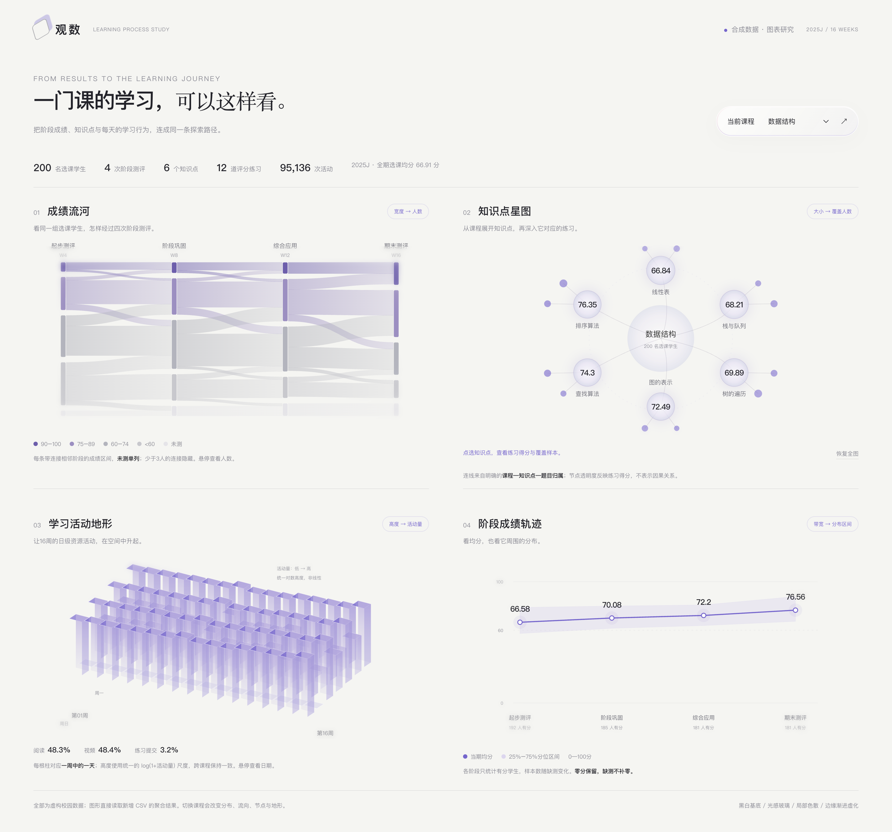

# AI 实施说明：将项目统一为已确认的图表页面风格

更新日期：2026-11-03。用途：供后续 AI 阅读、实施和验收。本文汇总本轮对话的最终决定；视觉依据是用户刚认可的学习过程图表页面。

## 最新追加评审：比赛展示打磨（2026-11-03）

本节是用户对正式界面实际体验后的新要求，覆盖下文与之冲突的旧限制；实施与验证结果另行记录，不以本节代替完成证明。

1. **首页必须有吸引力**：增加真实图表与有意义的文字，重新组织视觉叙事，不再把“一张主图”的详情页规则机械套给首页；避免只改配色、间距或加几张统计卡片。
2. **二级菜单以点击位置为原点放射展开**：简洁地指示可选方向，不从屏幕边缘滑出。圆形/放射布局是本轮明确要求，不能被旧的全直角规则否决；其它普通控件仍沿用当前直角语言。
3. **保留现有图表跳转逻辑**：用户认为目前逻辑不错。继续区分新主题与同数据换画法，打开、浏览候选和取消不提交导航。
4. **全览是实际图表的空间叠层**：参考用户再次提供的 Dotty Matrix 图片，大尺寸透明图表平面共用透视空间、沿纵深展开并相互遮挡；不能用二维卡片加鼠标跟随晃动代替。保留前后主题、左右画法及历史页回看。
5. **不做额外的 tap 快速选择标亮**：不新增快捷标亮模式；保留正常点击反馈与基本键盘操作，不将此要求误读为禁止键盘访问。
6. **整体转场更舒展、有展示感**：用户明确这是比赛展示，视觉表现优先于生产操作效率；旧文中的“快速”“不增加大量展示动效”不再是本轮约束。通过有层次的出入场与连续性建立节奏，而非一味缩短时长。
7. **落实渐进模糊及细节**：模糊应在空间边缘、聚焦和切换中被实际感知，不能只留颜色渐变；最终读数清晰，仍尊重减少动态偏好。

协作方式：Opus 主导前端设计与视觉实现，给予充分创作空间；DeepSeek 承担边界明确的简单基础代码；主代理整合并进行实际浏览器验收。子代理可查阅旧规划提取优秀想法，但不能把旧候选或效率优先约束当成用户新决定。先读本地已安装的匹配技能；本轮不是重做 AI、变更数据口径、提交或部署的授权。

### 本轮实际改动与验收记录（2026-11-03）

- 正式首页新增真实数据叙事：18门课程、选课人次、均分最高/最低，以及出勤×均分星图和六项课程分布。数据取自授权后的聚合 API，不构造虚假读数。
- 图表点选从点击位置展开简洁放射选单，分开显示新主题与同数据换画法。移除持久 highlight/data-highlight，只保留临时 hover 与键盘焦点。
- 全览以实际历史主题作为前后轴、同主题已访问画法作为左右轴；共享 perspective/translateZ 透明图表平面从真实历史缓存或同权限 API 恢复，不用占位读数。重复旧首页和同主题旧 URL 按主题合并。
- 桌面真实浏览器路径：数据结构均分图元 → 放射选单 → 出勤率—成绩关系页；URL 为 `browse=metric&indicator=attendance&relation=band-score`，范围是2025J、数据结构、200人。页面真实值：出勤83.45%、均分66.91、通过75.50%。
- 桌面图表形态切换：柱形 → 点位仅替换当前 URL，不新增 history、不再次请求聚合 API；Escape 取消不提交导航并恢复原焦点。
- 全览实际路径：全览中按主题导航聚焦较早的数据结构平面，进入按钮回到该主题 URL；真实画法平面并列在主题横轴，回看不创建重复主题记录。
- 旧 sessionStorage 里的重复首页和不同 drawing URL 已规范化合并；当前四个主题：课程全景、数据结构、Web前端开发、出勤率—成绩（关系主题 views 保留 bars/dots）。
- 390px 手机实际菜单三列选项矩形在视口内、互不重叠（新主题 x=39–138、当前画法 x=136–235、点位 x=247–345）；全页无横向溢出，点击“新主题”真实进入 Web前端开发课程页。最终真实浏览器截图保存在 `output/showcase-refinement-2026-11-03/mobile-radial-final.png`。
- 最终 `tsc --noEmit` 通过；`lib/exploration/concepts.test.ts` 5/5 通过；隔离 production build `.next-showcase-final` 通过（17.35秒）。既有 `grade-store.ts:361` 动态文件追踪警告仍在，未改无关导入存储代码。

## 最新执行要求：本节覆盖下文冲突的旧方案

用户于 2026-11-03 评审预览后补充以下要求，并明确停止重做预览，先整理本文，供接下来直接实施。**记录文档不等于正式项目已经完成改造。**

### 1. 整体体验：流畅、直觉，不再像 dashboard

- 页面之间的切换是整个项目的体验要求，不局限于某张图或全览动画。导航、进入主题、返回、换画法都应有清楚、连续的反馈，不能生硬闪切。
- 动画服务于理解“从哪里来、到哪里去”：同数据换画法保持上下文；进入新主题表现聚焦；返回能认出原来的位置。具体动效方案由实施时结合页面确定，不把所有操作机械套成同一种模糊动画。
- 延续此前模糊渐进、光感和空间感方向，但不能靠长动画、持续漂浮或把正文糊掉来表现流畅。支持打断、连续点击与减少动态偏好；数据尚未到达时不拿旧读数冒充新页面。
- 当前预览仍有 dashboard 感，**不是用户认可的最终构图**。减少常驻指标栏、表格、统计摘要、工具条和多图并列，不能只换底色、圆角或主题色就当完成。

### 2. 全部界面控件改直角

- 用户明确要求“不要圆角了，全改成直角”，覆盖原胶囊按钮、圆角输入框、标签、卡片、弹窗和微弧玻璃面板规则。界面容器及控件采用 `border-radius: 0`，共享圆角 token 同步收敛。
- 参考用户附图一 CYBER BRUTALISM：提取硬朗直角、清楚对齐、细线和黑白基底的感觉，**不要求照搬整页网格、模块密度、荧光绿或工业装饰**，更不能因此增加 dashboard 感。
- 直角要求针对 UI 外形；圆形散点、弧线、弦图等数据编码不强行改成方形。玻璃、高光和局部色散可保留，但不再依赖圆润外形。

### 3. 单图阅读页：参考附图二的简洁排版

- 以“一张主图 + 大标题 + 简短范围/说明 + 少量导航”为核心，给图表和留白足够空间，呈现海报式阅读体验。
- 不再默认展示左侧完整指标表、顶部整排统计、常驻画法胶囊和大段口径说明。必要的关联选择、详细数据、口径与工具按需展开；减少常驻元素不是删除业务能力或隐藏必要单位、图例与样本状态。
- 附图二用来参考标题、说明、大图、留白和前后切换入口的关系；不是要求所有数据改画弦图，也不允许为画出连线而编造统计关系。
- 增加可发现的页面切换选项，例如清楚的前后入口及按需打开的目的地选择。具体位置与展开方式结合简洁构图确定，不默认恢复大侧栏或满屏选项。

### 4. 图表切换与二级选择

- 用户认为当前页面/图表切换逻辑还需改进，不能将现有预览的选择方式视为定稿。
- 可以参考昨天“点击后再进行二级选择”的菜单：先点图元或概念，再按需展示关联页面或画法选项；这是可参考的交互方向，不是要求原样恢复旧九宫格。
- 必须区分“去另一个问题/主题”和“同一份数据换画法”。前者改变探索中心，后者保持范围、数据口径与分母；四种学习过程图不能混成同数据的画法菜单。
- 保留“点课程看课程、点指标看指标”的概念语义；引用旧菜单的展开方式，不恢复未经用户选择就持续取学生交集的逻辑。
- 二级菜单应有当前项、明确选择、取消/关闭与键盘返回；仅展开、浏览候选或取消，不改变原图数据和阅读位置，不新增探索历史。选定目标后才执行对应切换。

### 5. 新参考与适用边界

- 用户附图一：CYBER BRUTALISM 网页，用于直角、硬朗结构与黑白视觉参考。
- 用户附图二：“弦图”海报式页面，用于单图页面简洁构图、主次关系、留白及前后导航参考。
- 用户新提供三个视频参考：
  - https://pin.it/z3uR6sJJH
  - https://pin.it/7eBsloEHF
  - https://pin.it/2wbp01Mf5
- 2026-11-03 实施时已在真实浏览器打开三个链接并重播部分视频画面：分别为 Text Animation Showcase、Features Section Scroll animation、Text Showcase, Content and About Section Inspiration。仅提取疏朗的文字层级、局部光感与内容显现方式；没有据此测出精确曲线或时序，不把它们的深色配色当成正式主题。
- 早期 `preview-2026-11-03-deprecated/` 已标记过时；`project-preview-2026-11-03/` 是保留的新目录，但其中被否定的预览不作为最终设计依据。本轮停止重做预览，不以预览完成度阻挡下一步实施。

### 6. 本轮新增验收重点

- 界面容器和控件为直角，没有遗留胶囊或微弧圆角规则。
- 单图阅读页第一眼看到的是标题与主图，不是指标墙、工具条或卡片网格；关联与画法入口仍可发现、可操作。
- 页面前后切换、进入新主题、换画法与二级菜单的反馈符合各自语义，连续操作不会串页、叠加过渡或错用旧数据。
- 菜单取消不改原图、不造历史；选定目标才切换；课程、指标、关系与同数据画法之间的边界保持清楚。
- 正式页面以实际浏览器画面和操作验证，不再用未经验证的静态稿、虚构数字或测试声明充当交付证据。


## 1. 任务与优先级

用户最新要求：

> 我觉得现在的风格很合适，总结下这轮对话的内容，以现在你给我的页面这种风格来改这个项目。总结成一个供 ai 阅读的文档。

**改造目标：将正式项目的视觉语言向本轮认可的页面统一。保留现有业务流程与数据含义，在现有项目上修改。**

本文最初为实施文档；用户随后已授权按本文改进正式项目。本轮范围为共享视觉、数据浏览阅读与二级选择，以及其它页面的颜色和直角继承；学习过程扩展数据接入仍是后续独立工作。实际完成项与验收证据记录在文末，不把写入说明等同于完成实现。

阅读和决策优先级：

1. 用户后续明确指令。
2. 本文与下方指定的已认可页面、实际截图。
3. 本轮素材专题：用于解释无边框、模糊、玻璃和空间视角。
4. 现有业务契约：权限、数据口径、探索路径、历史与导出等继续保留。
5. 早期视觉方案：仅供追溯。2026-11-02 的蓝色交互、纯白阅读面等旧视觉规则，不能覆盖本轮新方向。

## 2. 必须先看的视觉依据

| 资料 | 用途 |
| --- | --- |
| [认可页面 HTML](learning-process-study/index.html) | 观察真实布局、文字层级、材质、四种图表和换课表现；这是本轮主要视觉基准 |
| [页面实际截图](learning-process-study/preview.png) | 核对最终整体效果；截图来自浏览器渲染 HTML |
| [可编辑模板](../../scripts/learning-process-study.template.html) | 查询具体 CSS、SVG、边缘虚化及布局实现；不要只改生成后的 HTML |
| [图表研究与数据说明](learning-process-study/README.md) | 理解图表含义、聚合方式和已验证范围 |
| [较早的玻璃与全览样例](ai-frontend-preview/index.html) | 补充观察斜侧叠层与玻璃；优先级低于当前认可页面 |



**认可的是整套画面语言。** 不把样例中“观数”的品牌名、标题文案、固定四图布局、18门课程或示意数字自动改成正式项目要求。正式品牌、页面任务和真实读数沿用项目当前定义。

## 3. 本轮对话确定了什么

| 用户意图 | 最终执行要求 |
| --- | --- |
| 喜欢参考网页没有边框的设计感 | 内容铺在统一画布上，靠留白、对齐、字号和少量细线组织层级；减少逐层套卡片 |
| 图片是希望实现的总览视角 | 数据浏览总览参考斜侧、略俯视、平行页面沿纵深排列的视角 |
| 视频主要喜欢边缘模糊 | 全站形成中心清晰、外围逐步虚化的风格，静态时也可感知；堆叠移动不是主要任务 |
| 简洁黑白、有光感的玻璃、色散、少量主题色 | 黑白灰是主体，局部玻璃和细薄光谱边缘表现材质；彩色保持克制 |
| 现在给出的页面风格很合适 | 以学习过程图表页面作为实施基准，淡紫可作为当前工作强调色；不再从零探索另一套风格 |
| 想先看静态效果 | 先完成静态构图和材质，不要求为评审建设复杂动效与大量适配方案 |
| 不是生成图片，而是 HTML 转图片 | 展示效果必须来自实际 HTML 页面截图；可以同时给 HTML 文件，不能用 AI 生成图冒充界面渲染 |
| 尝试补充模拟数据并设计酷炫图表 | 已生成独立扩展与四种聚合图表；视觉可迁移，正式数据接入需单独完成 |


## 用户最终确定事项（2026-11-03 补充）

### 主题色与强调
- 淡紫 `#7666cc` 为**点缀色**，少量用于交互强调；主体依然是**黑白灰**。
- 后续构建时应使主题色参数方便切换（token 层级化），但当前只需实现紫色方案。
- 相关色系：
  - 基础紫：`#7666cc`
  - 浅紫背景/高光：`#dcd6ee` 或 `#e8e5f3`（用于分位带、背景层）
  - 透明紫：`rgba(118, 102, 204, 0.1–0.3)`（玻璃边缘、hover 状态）
  - 偏粉高光：`#f0ebf8` 或极细的 `rgba(255, 255, 255, 0.3)` 白（玻璃内侧）

### 圆角与直角策略（已被最新要求替换）
- 所有界面容器、控件、按钮、输入框、标签、菜单与弹窗均采用直角 `border-radius: 0`。
- 原胶囊 `999px`、容器 `4–6px`、玻璃面板 `12–16px` 规则作废。图表的数据编码形状不受此限制。

### 边缘模糊与过渡
- **用途**：页面切换、数据加载、状态过渡的视觉缓冲；静态外围可保留轻微空间虚化，不让正文或必要图表读数常驻模糊。
- **静态时**：图表外围、全览远层可用渐变 + 轻 `blur(2–4px)` 呈现空间感。
- **动画时**：
  - 过渡时间：`0.3–0.4s`（快速但不仓促）
  - 缓动函数：`cubic-bezier(0.22, 1, 0.36, 1)`（流畅出入）
  - 模糊强度：最高 `blur(8–12px)` 在中间，然后回到 0
- **降级**：不支持 `backdrop-filter` 时用**实色 `rgba(255, 255, 255, 0.95)` 替代**，保留层级关系。

### 等宽数字与字体
- **应用范围**：
  - 所有**数字**使用 `font-variant-numeric: tabular-nums`（等宽对齐）
  - 金融/表格数据优先
  - 图表轴标签、坐标值、百分比、学生数、成绩等
- **字体权重**：
  - 标题：`font-weight: 450` 或 `500`（中等，介于 400 和 600）
  - 正文：`font-weight: 400`
  - 强调/选中：`font-weight: 500–600`
- **宋体使用**（后续细化，暂不改代码）：
  - 保留 `--font-serif` 定义
  - 标记为"后续可在大标题或品牌文案中试用"
  - 不强制现在就改，避免破坏现有排版

### 小样本/数据缺失状态
- **视觉表现**：
  - 缺失柱子用 **`#d0d0d8` 灰色** + **轻 `rgba(..., 0.4)` 透明度**，暗示"无法交互"
  - 加上 **微弱玻璃感**：`backdrop-filter: blur(2px)` + `box-shadow: inset 0 1px 3px rgba(0,0,0,0.05)`
  - Hover 时**不高亮**，仅显示 tooltip："样本小于3人，已隐藏"
- **交互**：纯信息提示，无法点选

### 键盘焦点与交互反馈
- **焦点状态**：
  - 边框：`2px solid #7666cc`（紫色）
  - 外圈阴影：`0 0 0 4px rgba(118, 102, 204, 0.15)`（微妙发光）
  - 过渡动画：`outline-offset 0.2s ease-out, box-shadow 0.2s ease-out`
  - 不直白，配合切换动画保持柔和感
- **Hover 状态**：
  - 背景/边框轻微变化 + `box-shadow: 0 2px 8px rgba(118, 102, 204, 0.1)`（紫色微光）
  - 过渡时间：`150ms`
- **Active/按下**：缩小 `scale(0.98)` 或改变透明度，保留反馈但不过度

### Loading 与空状态
- **Loading 动画**：
  - 旋转圆点或进度环，**紫色** `#7666cc` 或 **灰色** `#c0c0c8`
  - 不用完全实心，用 **渐变 + 虚化** 表现轻盈感：`background: conic-gradient(#7666cc, transparent 30%)`
  - 旋转速度：`0.8–1s` 一圈（不急促）
- **空状态**：
  - 简单的**文字提示** + **大留白**（参考认可页面风格）
  - 可选轻量插画（极简、不花哨）
  - 不用浓重过渡动画，保持页面清冷气质

### 图表交互的紫色强度
- **单个数据点/条 hover/选中**：`rgba(118, 102, 204, 0.25–0.35)` **半透明紫**，保留背景可见
- **不用饱满实紫**（会显得突兀）
- **协同高亮**：相关图例、标签、坐标值同时用同一紫色调高亮，保持视觉连贯
- **过渡**：`150ms ease-out`（快速但平滑）

### 打印与导出
- **PDF/图片导出**：
  - 移除或简化**模糊边、半透明玻璃**（改用实色 `#ffffff`）
  - 保留**核心数据和图表**，去掉装饰层
  - 保证**可读性第一**（字号、对比度、单位清晰）
  - 页脚加上**导出时间、数据源标注**
- **打印预览**：用 `@media print { ... }` 隐藏浮层、菜单、AI 入口

### 全览空间透视（鼠标移动轻微位移）
- **静态时**：页面按 `rotateX(5–8deg)` 轻微俯视，营造空间感
- **鼠标移动**：
  - 根据鼠标位置计算偏移，最多 ±2–3px 水平/垂直位移
  - 用 `transform: translateX/Y(...)` 实现，**不改透视角**
  - 过渡延迟：`50–100ms`（跟得上鼠标但不过敏感）
- **移动设备**：禁用（改用静态俯视）

### 不支持 backdrop-filter 的降级
- 用 **实色半透明背景** 替代玻璃模糊：`background: rgba(255, 255, 255, 0.92)`
- 保留 **box-shadow** 制造深度感：`0 4px 12px rgba(0, 0, 0, 0.08)`
- **装饰层** 直接隐藏或改用低对比渐变

### 深色模式（暂不改，记录待做）
- 当前保留既有深色 token：`#0b1220` 底、`#edf2fb` 文字、`#8ab4ff` 蓝色
- 后续统一时参考浅色逻辑，用**冷黑 + 淡紫对应体系**

---


## 4. 将风格转成可执行规则

### 4.1 画布与层级

- 默认以接近暖白的连续画布承载内容，主文字接近黑色。页面有呼吸感，图表本身成为主体。
- 标题、简短说明、当前范围、图形、图例与口径形成清楚顺序。保留样例中细小编号、轻量标签和较大的章节留白。
- 内容区以布局和细分隔线形成关系。浮动选择器、菜单、输入与关键操作可有玻璃容器，不把所有信息包成厚重玻璃卡片。
- 参考页面的两列图表只是一种布局示例；正式课程、指标、关系页面按实际任务组织。不要把整个项目替换成四图展示页。

### 4.2 颜色与文字

以下值取自认可页面，作为初始视觉参数，集中映射到项目现有 token，避免在组件中各自建立一套色板。

| 角色 | 样例值或表现 | 迁移要求 |
| --- | --- | --- |
| 画布 | `#f5f5f2` | 暖白、轻灰，避免大面积蓝底 |
| 主文字 | `#232329` | 标题与关键数字清楚、接近黑色 |
| 辅助文字 | `#8a8a94` | 保留轻盈感；正式小字号文本按可读性适当加深，不逐字照搬低对比 |
| 强调色 | `#7666cc` | 少量用于当前选择、焦点、图形主线和重点状态 |
| 弱分隔 | `#24243615` | 细薄、低存在感，只承担组织作用 |
| 玻璃与光边 | 半透明白、淡紫、少量偏粉高光 | 克制地放在浮层和玻璃边缘 |

- 常规中文使用系统无衬线；大标题可少量借用样例的宋体片段形成节奏。正文、表格与控制标签保持清楚。
- 数字采用等宽数字排布。正文与操作文字按正式页面阅读需求设置，不照抄样例为截图压缩的 8–11px 字号。
- 成绩区间、类别、连续量、成功/警告/错误各自保留明确语义。紫色是视觉主调，不要求把所有统计分类和语义状态改成紫色。
- 深色模式保留既有功能与用户偏好，后续沿相同材质原则处理；本轮没有确认新的深色效果稿。

### 4.3 光感玻璃与色散

- 玻璃以透光、柔和渐变、薄高光边缘和轻微阴影呈现，画面整体保持干净。
- 样例玻璃**基础参数**：
  - 背景模糊：`backdrop-filter: blur(15px)`（起点参考，单个组件可调整至 8–20px）
  - 半透明白渐变：`background: linear-gradient(125deg, rgba(255,255,255,0.8), rgba(255,255,255,0.3))`
  - 顶部内高光：`inset 0 1px 2px rgba(255,255,255,0.8)`（顶边 1–2px 白色内阴影）
  - 底部淡紫细边：`inset 0 -1px 2px rgba(118,102,204,0.2)`（底边 0.5–1px 紫色内描边）
  - 外层阴影：`0 4px 16px rgba(0,0,0,0.08)`（轻微、柔和）
  - 外形：`border-radius: 0`，遵循最新直角要求。
- 选择器、标签、按钮与内容面均保持直角，不再使用胶囊外形。
- **色散**：
  - 局部出现于**玻璃边缘**（可用渐变模拟光谱）或**高光过渡处**
  - 避免整页彩虹、大片霓虹、高饱和发光背景
  - 参考实现：玻璃底边可用 `linear-gradient(90deg, transparent, rgba(220,214,238,0.3), transparent)` 暗示色散
- 优先复用 CSS、现有 SVG/图表能力；本轮风格不要求引入 WebGL、复杂折射引擎或新的重型动效依赖。


### 4.4 边缘模糊

- **这是全站主要风格之一，不能只剩切换时一次短暂模糊。** 静态页面可通过画布外围、图形远端、玻璃边缘及全览远层体现清晰度过渡。
- 焦点内容、关键数字、正文、表格、坐标与当前操作保持清晰；模糊主要落在外围视觉层，不能把整张图或整个内容根节点一并糊掉。
- 样例对图形外围叠加渐变遮罩的 `backdrop-filter: blur(4px)`，中心透明、外缘逐步生效。可参考其方法，正式实现要把必要图例与读数置于清晰区域。
- 装饰层设置 `pointer-events: none`，不遮挡图元命中、悬浮提示与键盘焦点。
- 页面停留时无需持续漂浮或脉动。若增加转场，只用于聚焦和上下文衔接；减少动态即时切换，降低透明度或不支持滤镜时采用清楚的实色/静态替代。

### 4.5 总览空间

- 图片负责斜侧观察角度，视频负责边缘虚化。不要将视频的正面堆叠或持续翻卡当作必做功能。
- 暂以现有左下“全览”的探索历史为迁移落点，保持前后为主题、左右为画法的语义；这属于实施建议，用户此前未单独确认“总览”指哪个入口。
- 远层适当柔化、当前层突出；进入阅读后恢复清楚的正常页面。透视只表达空间与历史组织，不暗示成绩高低或课程重要性。
- 不为复刻图片改变现有历史恢复、主题定位和画法切换规则。

## 5. 数据与图表：已有成果及接入边界

### 5.1 现有数据来源

- 内置 `demo`：`data/sample/` 的模拟校园数据，原有学生、居住、请假、出勤、作业、学期汇总、选课成绩与周活动八张 CSV。
- 内置 `oulad`：`oulad_raw/` 的 OULAD 文件。不能假设它拥有校园出勤、请假或本轮自编知识点。
- 管理端 Excel/CSV 成绩导入：按发布后的真实字段与版本开放能力；代码支持不等于当前环境已发布某份数据。
- 本轮新增 `data/sample/learning-process-v1/`：独立模拟扩展，**尚未注册为正式数据源，也未接入正式查询、数据浏览或 AI 工具**。

### 5.2 本轮新增模拟数据

范围：2025J、1,200名虚构学生、18门课程、3,600次选课、16周。原八张表保持不变。

| 新表 | 行数 | 作用 |
| --- | ---: | --- |
| `knowledge_points.csv` | 108 | 课程知识点与教学周范围 |
| `knowledge_links.csv` | 90 | 明确编排的教学顺序 |
| `assessments.csv` | 72 | 每课四次阶段测评 |
| `assessment_items.csv` | 216 | 测评与知识点所属的评分练习 |
| `learning_resources.csv` | 432 | 阅读、视频与练习资源 |
| `stage_scores.csv` | 14,400 | 阶段得分与缺测状态 |
| `item_attempts.csv` | 50,497 | 首次及可选再次提交 |
| `daily_activity.csv` | 434,463 | 日级资源活动桶 |

生成与校验分别使用 `scripts/generate-learning-process.py`、`scripts/validate-learning-process.py`。详细规则见[扩展数据说明](../../data/sample/learning-process-v1/README.md)。

必须保留的解释：阶段成绩由原总评锚点合成；日级活动加总与原周活动一致；时长另行模拟；知识点关系是编排关系；练习均分不等于经验证的知识掌握度。课程完成标记 `course_completed` 与阶段缺测状态分开。

### 5.3 四种图表的正式迁移方式

| 图表 | 数据编码 | 应保留的解释与交互 |
| --- | --- | --- |
| [成绩流河](learning-process-study/01-成绩流河.png) | 相邻阶段成绩分组之间的人数控制带宽 | 保留未测通道、分数组、阶段、悬浮人数；区分未测与0分 |
| [知识点星图](learning-process-study/02-知识点星图.png) | 圆面积表示覆盖人数，透明度表示最新练习均分，小节点大小表示设定难度 | 课程→知识点→练习可点选展开；关系来自明确归属，不伪造相关性 |
| [学习活动地形](learning-process-study/03-学习活动地形.png) | 16×7天，每柱高度按统一的 `log(1+活动量)` 标尺 | 斜视玻璃柱体现空间感；可查日期、活动量、人数与模拟时长，不每次换课重置高度尺度 |
| [阶段成绩轨迹](learning-process-study/04-阶段成绩轨迹.png) | 均分曲线与25%–75%分位带 | 保留单位、分位含义、各期有分人数；缺失不补零，不将群体均分上涨直接称为个人进步 |

整合建议：共用数据源、课程与学期上下文，按“阶段过程—知识内容—日级节奏”衔接探索。点击知识点或某周可成为新的探索中心，关联强调来自时间、目录或明确分组。

**四图回答不同问题，不能放进同一份结果的“只换画法”菜单。** 需先扩展场景、指标或关系契约，再决定每个聚合支持哪些等价画法。视觉连接也不能伪装成统计关系。

任何新图都要说清：数据来源 → 聚合粒度与样本 → 数值如何改变图形 → 切换数据后实际改变什么。无字段支持时显示未开放或缺少数据，不借用模拟值补齐 OULAD 或导入成绩。

## 6. 在现有项目中怎样修改

先读取仓库 `AGENTS.md` 及其引用文件；写 Next.js 代码前读取安装版本 `node_modules/next/dist/docs/` 的相关指南。工作区可能有用户或其它任务的未提交修改，先核对差异并保留。

| 范围 | 优先查看的文件 | 改造重点 |
| --- | --- | --- |
| **共享 token 与主题** | `app/tokens.css`、`app/layout.tsx` | 将浅色画布映射到 `#f5f5f2`、主文字映射到 `#232329`，统一淡紫与玻璃参数；界面圆角 token 全部归零，不新增胶囊变体 |
| **基础层级与分隔** | `app/globals.css`、`app/glass-workspace.css` | 删除或简化不必要的 `box-shadow` 和多层卡片；用细线 `border-top: 1px solid var(--line)` 分隔 section；验证 `prefers-reduced-transparency` 的降级方案 |
| **共享颜色、文字与材质** | `app/glass-controls.css`、`app/glass-hierarchy.css` | 将认可样例映射到共享 token；核对 CSS 引入与覆盖顺序，避免新旧主题竞争；补充等宽数字规则 `font-variant-numeric: tabular-nums` |
| 数据浏览 | `components/data-explorer.tsx`、`components/data-explorer.module.css`、`components/concept-chart.tsx`、`components/concept-chart.module.css` | 开放画布、当前上下文、图元质感、**系统性边缘虚化**（新增 `.edge-fade` 工具类）、全览;修改底色用 `var(--background)`、强调色用 `var(--accent)` 替代硬编码;小样本改灰 + 虚化 |
| 工作台与 AI | `components/workspace.tsx`、对话相关组件及样式 | **暂时只改 token 和颜色继承，不改布局**；统一导航、输入、消息浮层用新 token；保留阅读与交互流程 |
| 登录、账号、管理、导入 | `components/login-screen.tsx`、`app/glass-auth.css`、管理与导入组件样式 | **暂时只改 token 和颜色继承，不改布局** |
| 数据接入 | `lib/datasets/service.ts`、`lib/analysis/duckdb.ts`、`lib/analysis/concept-query.ts`、`lib/analysis/concept-explorer.ts`、`app/api/concept-explorer/route.ts`、`lib/exploration/` | 接入新表时再扩展服务端能力、场景与聚合契约；不将预览 JSON 直接当正式后端 |

**Token 修改清单**（优先级）：

1. **颜色体系**：
   - 浅色主题新增/修改：
     - `--background: #f5f5f2`（暖白）
     - `--ink: #232329`（近黑）
     - `--muted: #6b6b76`（正式辅助文字；由样例灰加深，保证暖白底可读性）
     - `--accent: #7666cc`（淡紫，替代或并行蓝色）
     - `--accent-light: #dcd6ee`（浅紫，背景高光用）
     - `--accent-transparent: rgba(118, 102, 204, 0.15)`（透明紫）
     - `--line: #24243615`（弱分隔，极淡）

2. **玻璃与材质**：
   - `--glass-blur: blur(15px)`（起点参考）
   - `--glass-fill: linear-gradient(125deg, rgba(255,255,255,0.8), rgba(255,255,255,0.3))`（渐变）
   - `--glass-inner-glow: inset 0 1px 2px rgba(255,255,255,0.8)`（顶部白高光）
   - `--glass-rim-color: rgba(118, 102, 204, 0.2)`（底部紫细边）
   - `--surface-glint: rgba(118, 102, 204, 0.08)`（柔和紫色微光，替代蓝色）

3. **圆角**：
   - 现有界面圆角 token 统一为 `0`；移除胶囊、微弧等相互冲突的外形约定。

4. **字体与排版**：
   - 保留现有 `--font-sans`、`--font-serif`、`--font-mono`
   - 可添加 `--font-weight-body: 400; --font-weight-title: 450; --font-weight-bold: 600;`（后续用）
   - 数字处理：每个 `<span class="tabular">` 或数字容器加 `font-variant-numeric: tabular-nums`（暂不强制全局）

5. **动画**：
   - `--transition-fast: 150ms cubic-bezier(0.4, 0, 0.2, 1)`（hover/active）
   - `--transition-smooth: 300ms cubic-bezier(0.22, 1, 0.36, 1)`（进入/离开）
   - `--transition-focus: 200ms ease-out`（焦点变化）


建议按三个递进阶段实施：

**第一阶段：Token 与基础视觉统一（必做，无依赖）**
- 更新 `app/tokens.css`，补充紫色体系、玻璃参数、圆角定义
- 在 `app/layout.tsx` 确保新 token 全局生效
- 验证 `prefers-reduced-transparency` 和不支持 `backdrop-filter` 的降级方案
- **验收**：整个项目用新色板，但交互逻辑不变；仅颜色和基础样式改动

**第二阶段：数据浏览阅读与交互（本轮主要工作）**
- 改造 `components/data-explorer.tsx`、`concept-chart.tsx` 及其 CSS Module。
- 采用大标题、简短范围、一张主图和留白；原常驻指标表、关联列表、画法选项和口径说明改为按需展开，不删除能力。
- 图元点选先打开二级选择，明确区分进入新主题与同数据换画法；取消不改图、位置或历史，明确选择后才切换。
- 提供前后阅读入口与目的地选择；保留 URL、浏览历史、全览和 AI 往返。
- 外围装饰虚化与焦点发光不影响读数；新主题、换画法、返回分别提供短促连续反馈，并支持减少动态和连续操作。
- **验收**：真实浏览器切换至少两门课程，核对读数、菜单取消、同数据换图、前后返回、键盘、窄屏、全览与 AI 往返。

**第三阶段：AI、登录、管理等页面（本轮仅继承视觉）**
- 只改 token、颜色与直角外形，不改布局与业务流程。
- 验证各页面在新色板下的可读性
- **验收**：颜色统一，功能不影响

这三个阶段是实施顺序建议，**不要求为了改风格重建整个系统**。优先完成第一、二阶段，第三阶段可放宽时间。


学习过程数据与四种新图属于后续独立扩展：在模拟数据源下注册服务端聚合与场景契约后再接入，不是本轮视觉改造的完成前提，也不能因静态样例可换课而声称正式业务已经支持。

## 7. 必须保持的业务行为

- 数据源与账号权限、少于3人的非空分组抑制、个人明细不进入前端响应和 URL。
- 课程→指标→关系循环；点选形成新的中心，不默认持续取学生交集。相同聚合的换画法不改问题或分母。
- 数据源、学期与课程切换不串用结果；取消旧请求，迟到结果不覆盖当前页面，加载时不展示旧课读数。
- URL、前进后退、全览、阅读位置、AI 往返与历史恢复继续工作。
- 进入 AI 保留可移除的浏览参考、输入草稿与原对话，不自动提问或自动创建新对话。
- 导入版本、查询依据、指标定义、单位、样本与导出能力保持真实；打印与报告输出保证清晰。
- 键盘操作、焦点、窄屏基本可用、减少动态与透明度替代继续保留。“先看静态”不意味着删掉已有可访问能力。

业务细节以[工作台指南](../workspace-guide.md)、[架构说明](../architecture.md)和对应源码为准，视觉改造不附带改写业务规则。

## 8. 实施后的交付与验收

- 先看静态整体是否接近认可页面：暖白与近黑、克制淡紫、留白、细线、轻玻璃、局部色散、外围虚化。
- 检查当前选中状态、文字读数、图例、表格与操作焦点是否清楚，装饰层是否影响点击。
- 保留代表性的桌面页面截图与窄屏检查；优先复用已有响应式逻辑，不为本轮增加大量展示动效。
- 切换至少两门课程或两个有差异的范围，确认图形与读数确实响应数据；缺测、小样本、空数据与不支持字段有明确状态。
- 按实际改动做一次类型检查与相关定向验证。涉及查询、权限或新数据契约时补相应检查；不为纯样式变动机械重跑全部无关流程。
- 交付实际浏览器截图，直接内嵌展示，另给本地 HTML 或页面入口；不只发无法查看的下载链接。预览服务需确认能访问。
- 明确说明已改页面、尚未接入的数据、验证范围和未验证部分。没有提交、推送或部署时不声称已上线。

## 9. 素材追溯与本轮未决定的事项

- 无边框三个视频：[2XASXqvAo](https://pin.it/2XASXqvAo)、[vBefOcTJc](https://pin.it/vBefOcTJc)、[11DSREDnV](https://pin.it/11DSREDnV)。本地关键帧与拆解见[无边框专题](ai-frontend-reference/borderless-web.md)。
- 边缘模糊视频：[74FDRvYo6](https://pin.it/74FDRvYo6)；总览视角图片：[33RrxhXoa](https://pin.it/33RrxhXoa)。本地原图、视频与关键帧见[总览专题](ai-frontend-reference/overview-stack.md)及[边缘模糊专题](ai-frontend-reference/edge-blur.md)。
- 本轮未选定或安装任何专用前端 Skill。最初提到 Skill 是希望积累方法，不构成依赖某个 Skill 的实施要求。
- 当前没有要求品牌改名、复制 Pinterest 素材作为成品资产、建设重型动画系统、发布网站或提交代码。

## 10. 可直接交给下一位 AI 的任务文本

```text
先读取 docs/design/ai-implementation-brief-2026-11-03.md，
打开其中指定的 learning-process-study/index.html 与 preview.png，
以用户已认可的页面作为视觉基准改造现有项目。

方向：暖白与近黑、少量淡紫、开放画布、细薄分隔、光感玻璃、
局部色散、中心清晰而外围渐进虚化。先把静态画面做好。
最新要求：UI 全直角；去 dashboard 化，单图阅读页采用大标题、简短说明、
一张主图与大留白；加入直觉、流畅的页面切换与可发现的导航选项。
参考点击后二级选择菜单，但区分关联跳转与同数据换画法；
打开和取消菜单不改变原图或新增历史。先读本文最前面的最新执行要求。
优先统一共享 token 和数据浏览，再延展其它正式页面。
保留现有权限、数据口径、探索循环、URL/历史、AI、导入和导出。

不要把旧蓝白规范当成最新目标，不把整个产品替换成四图展示页。
学习过程模拟扩展尚未接入正式业务；四图属于不同聚合，
如实施数据接入，应扩展相应场景与服务端契约，并验证真实换数表现。

完成后直接展示实际 HTML 浏览器截图，说明改动与验证边界。
```

## 11. 本轮实际实施与验证（2026-11-03）

### 已落地

- DS 完成共享 token、控件、登录、AI、管理、导入等 CSS；Opus 完成数据浏览设计与四个前端文件，主代理收口交互、可访问降级、报告和验收。调度按用户要求传入 medium；子任务运行时未提供可核实的实际思考档位，不将“请求中等”当作已测得的模型内部档位。
- 正式数据浏览已改为单图阅读；课程、指标、画法、读数与口径按需打开。图元点击先出现二级选择；关联跳转与同数据换画法明确分组；保留前后页、全览、URL 与 AI 往返。
- 浅色暖白／近黑／淡紫，所有 UI 容器和控件直角。大标题保留系统无衬线，不在本轮强制切换宋体；数字等宽。深色保留原色板，数据浏览继续固定浅色。
- 主题切换不再使用会暂时阻塞文档交互的全页截图；使用实时颜色过渡。报告使用一致浅色与直角，附生成时间与来源，打印为白色实底。
- 未接入 `learning-process-v1` 或四种新图，未改后端权限、数据聚合口径、AI 服务及导入发布契约，未新增依赖。

### 验收证据与边界

- 类型检查通过；概念导航／聚合／图表选项／报告导出四组共39项测试通过；隔离生产构建与原生 DuckDB 库准备成功。
- 真实生产浏览器核对数据结构、数据库原理；验证菜单 Esc 取消五项不变（URL、原图 DOM、滚动、历史长度、探索条目）与焦点恢复；同数据换画法0新增查询；课程—指标—关联、显式跨科、原生及页内前后、刷新、全览三画法均已操作。
- 320／768／1024／1440 宽无全局横向溢出，390宽 SVG 键盘操作与 AI 草稿／参考／180px阅读位置往返通过；进入 AI 不新增服务端对话。
- 隔离导入8条CSV：真实0分保留、2人组抑制且不可点击、无字段指标保持缺失。注入503后原位重试，以及900ms慢请求后回首页不串页，均通过。
- 系统减少动态／透明度与应用动效开关实际操作；减少透明度时浮层实色且无滤镜。登录、深色管理、导入选择控件、18行报告与打印媒体检查通过。
- 仍有原 `grade-store.ts:361` 动态文件追踪告警。未重复全套无关测试，未验收真实外部 AI、真机软键盘或无滤镜的旧浏览器。JS 页面异常未观察到；重启断连、主动取消与注入错误单独计。
- 截图保存在 `output/design-implementation-2026-11-03/`；详细操作证据见[工作台指南](../workspace-guide.md#2026-11-03直角视觉与单图阅读改进)。本轮未提交、推送或部署。
