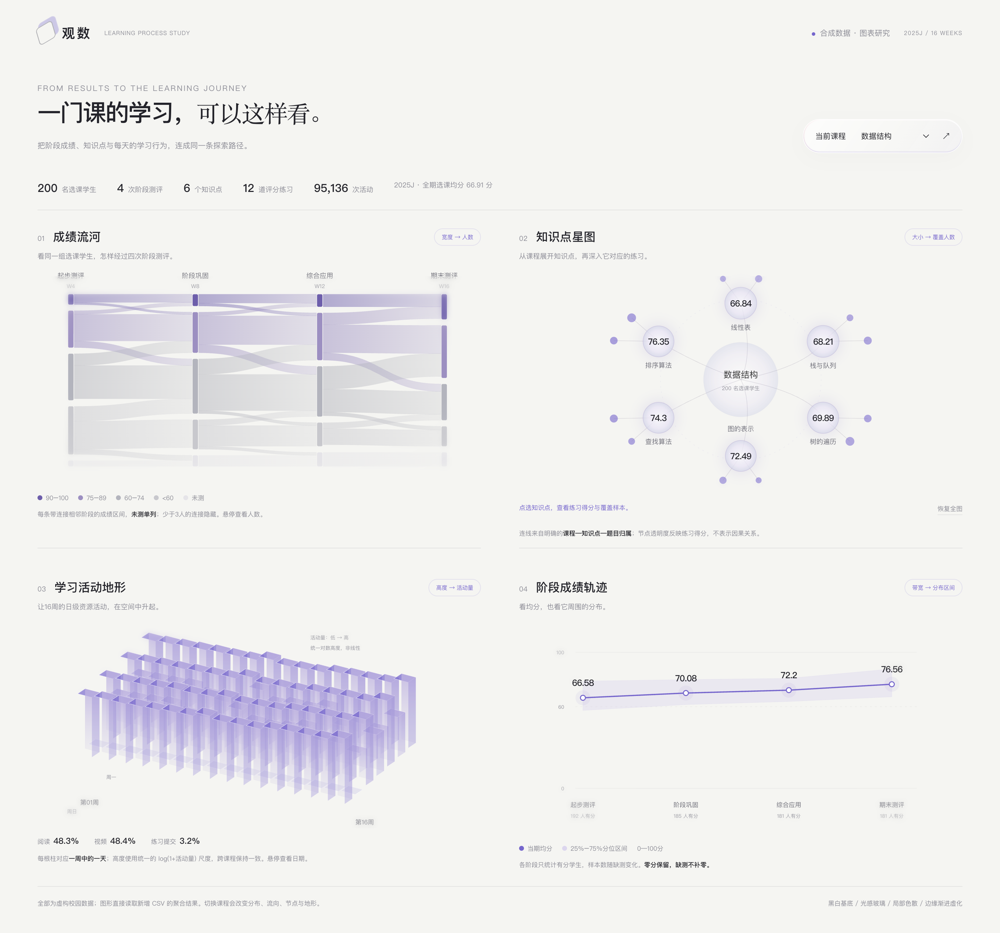

# 学习过程图表研究：用新增模拟数据驱动四种表达

2026-11-03。用户授权尝试生成阶段成绩、知识点与答题、日级活动数据，并思考它们如何整合成更有表现力的图表。

[打开单文件 HTML](index.html) · [浏览器实际截图](preview.png) · [扩展数据与复现说明](../../../data/sample/learning-process-v1/README.md)

**后续评审结果：** 用户已认可本页整体风格，并要求以此改造项目。[AI 实施说明](../ai-implementation-brief-2026-11-03.md)汇总了本轮对话与正式迁移要求。风格确认不代表这四种图表或新表已接入正式应用。

## 本次交付

- 数据范围：2025J、1,200名虚构学生、18门课程、3,600次选课、16周。目录、生成规则和检查结果见数据说明。
- 页面直接内嵌新增CSV聚合出的JSON，默认显示数据结构，可切换18门课；只包含聚合结果，不包含学生编号。
- 原站的总览、概念循环、API、数据源列表和AI工具未改动。这是供评审的独立数据与图表样例。
- 保留黑白基础、少量紫色候选、柔和光感和边缘虚化。没有为本轮增加复杂动画或大规模适配。

## 四种图表各自解释什么

| 图表 | 数据来源与聚合 | 画面如何随数据变化 | 适合回答的问题 |
| --- | --- | --- | --- |
| **成绩流河** | 同一次选课的4个阶段成绩，按分数组及未测分组，统计相邻阶段流向人数 | 带宽随人数变化，带的路径随分数组转移；未测单独一条通道 | 有多少人保持原分组、上移、下移或未参加后续测评？ |
| **知识点星图** | 课程→知识点→评分练习的明确归属；练习取最新一次得分后聚合 | 知识点圆面积与覆盖人数对应，透明度随练习均分变化，小练习节点大小随设定难度变化 | 哪些知识点练习得分较低，覆盖了多少人，对应哪些练习？ |
| **学习活动地形** | 日级活动按课程、教学周与星期聚合，共16×7个格子 | 每根柱对应一天，高度使用所有课程共用的log(1+活动量)尺度，颜色随高度变化 | 活动集中在哪些周、哪些天；不同课程的节奏有何不同？ |
| **阶段成绩轨迹** | 各阶段有分样本的均分、25%与75%分位 | 曲线位置随均分变化，色带上下边界随分位变化；样本数单独标明 | 同时观察平均水平与成绩分散程度，避免均分遮蔽分布 |

这是四种不同聚合，不应直接塞进正式项目的“同一数据换画法”菜单，造成换图时悄悄更换问题或分母。

## 可继续深化的整合方式（设计建议）

1. **共享上下文。** 四图共用课程和学期；每幅图始终保留自己的指标、样本与口径。
2. **把选择变成新的探索中心。** 点一个知识点，可以进入该知识点的题目、首次/再次练习对照；点第8周，可以进入该周的活动构成和对应阶段测评。不要默认把每次点击变成越来越窄的学生交集。
3. **让关联可追踪。** 选中某个阶段时，可同时强调对应教学周与相关练习。连接必须来自目录、时间或明确分组，不能凭画面需要添加统计相关性。
4. **用连续构图连接四种尺度。** 课程是入口，流河显示阶段过程，知识点星图展开内容结构，地形显示日级节奏。未来可以在一张大画布中沿时间轴衔接，当前四图先独立验证语义。
5. **先让静态画面成立。** 数据改变带宽、高度、节点或区间已经能形成表现力。后续如加动效，可用于聚焦和衔接，不以漂浮粒子代替数据编码。

## 已核对的换课表现

浏览器实际从“数据结构”切到“高等数学”：选课人数均为200，活动总量从95,136变为57,186，源总评均分从66.91变为57.65，阅读/视频/练习构成与四幅SVG均更新。两者使用同一地形高度标尺，避免每次自动放大后看起来一样高。

数据结构的阶段轨迹从66.58到76.56分，但各期有分人数为192、185、181、181。它不能直接证明全体200人的学习进步；个人阶段成绩是依据既有总评合成的，缺测导致各期样本不同。页面同时保留样本数与“未测”流向。

## 生成、样式与检查边界

- 数据生成：`scripts/generate-learning-process.py`；独立校验：`scripts/validate-learning-process.py`。
- HTML模板：`scripts/learning-process-study.template.html`；内嵌数据来自 `data/sample/learning-process-v1/visualization-data.json`。
- 通过CSV一致性与字节级复现检查、JavaScript语法检查。Edge实际打开本地HTML，检查四图显示与换课更新，并导出整页PNG。没有进行正式接口、AI模型或全设备验收。
- 以原生SVG实现样例，没有新增运行依赖。关于图表语义，桑基式布局用数值控制节点和连接宽度，可参考 [D3 Sankey 官方说明](https://github.com/d3/d3-sankey)；分布区间由上下边界构成面积带，可参考 [D3 Area 官方说明](https://d3js.org/d3-shape/area)。本样例未直接引入D3。
