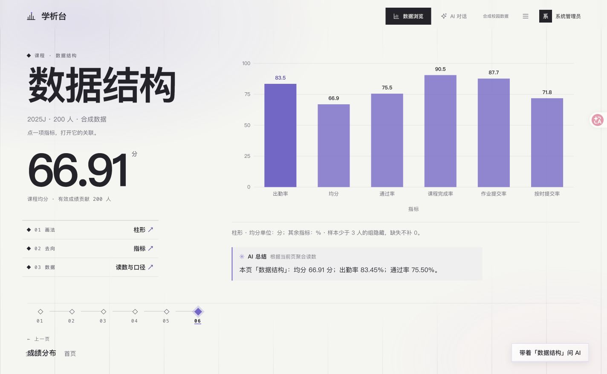

# 学析台 · 项目介绍

学析台面向教师与教学分析人员，将课程图表、自然语言分析和结果导出组织为一个 Web 工作台。使用者可以先看课程概况，再围绕发现的线索连续提问，核对统计数字及指标依据，最后保存分析结果。

## 应用流程

课程全景 → 课程指标 → 学习关系 → AI 连续分析 → 核对依据 → 导出结果。



1. 登录后选择获授权的数据源，查看课程全景与学期范围。
2. 进入一门课程，阅读出勤率、均分、通过率等指标，按需查看数据与口径。
3. 点击指标继续探索关联，或对同一数据切换图表画法。
4. 切换到 AI 对话，提出课程比较、学期变化或成绩分布问题，并继续追问。
5. 核对图表、数值表、统计范围与知识依据，下载 CSV、HTML 或打印另存 PDF。

## 核心功能

| 功能 | 使用方式 |
| --- | --- |
| 连续数据浏览 | 从课程进入指标和关系，保留主题轨迹，支持前后回看 |
| 自然语言分析 | 课程均分、跨学期比较、成绩分布与多步任务 |
| 知识与统计依据 | 按指标定义、数据来源、样本数和引用核对分析结果 |
| 账号历史 | 服务端保存并按账号隔离对话，支持重新打开与续聊 |
| 成绩导入 | 管理员上传 Excel/CSV，映射字段、校验并发布数据集 |
| 结果导出 | 聚合 CSV、HTML 报告及浏览器打印 PDF |
| 系统管理 | 账号、数据授权、模型连接、预算、用量与操作日志 |

## AI 技术落地

AI 负责理解问题、选择受控工具并组织解释；DuckDB 在服务端完成统计计算。工具参数经过结构校验和权限检查，模型不能直接执行任意 SQL。多步任务将前一步结果作为后一步条件，例如先比较学期，再选择课程查询分布。

知识检索提供指标定义、数据来源及统计口径，引用保留来源与版本。FactRef 将回答数字与程序统计结果绑定，便于读者核对。

2026-11-15 的指定真实模型场景验证使用 qwen3.8-flash 与真实 DuckDB，统一场景 7/7、多步场景 3/3；另从原始 CSV 独立复算对应统计数字。这些是指定场景的记录。

可体验的问题：

```text
比较2025J各课程的平均成绩。
那2025B呢？
比较2025B和2025J，找出均分下降最多的课程，再看它在2025J的成绩分布，并解释比较口径。
```

自由提问需要管理员配置可用模型连接、密钥与预算，并完成连接检测。

## 技术与数据

前端使用 Next.js、React、TypeScript 和 ECharts；服务端使用 DuckDB、OpenAI SDK 兼容协议与 Zod。项目提供 pnpm 锁文件、Docker 配置、环境变量模板和自动检查工作流。

默认合成校园数据包含 1,200 名匿名学生、18 门课程与 4 个学期，用于功能展示和验证；项目还支持按来源与许可单独获取 OULAD 公开数据，以及管理员发布的获授权成绩数据。各数据源根据实际字段提供分析能力。

## 运行与阅读入口

- [安装与启动](../README.md#本地运行)
- [工作台使用指南](workspace-guide.md)
- [成绩导入](grade-data-import.md)
- [系统架构](architecture.md)
- [部署说明](deployment.md)
- [第三方来源与许可证](third-party-notices.md)

团队：少男乐队，大连东软信息学院，B 组。成员与分工见 [README](../README.md#参赛团队)。

项目此前未发表、未获奖，未基于其他现成完整项目或成套模板开发。第三方依赖与组件改编保留各自来源及许可证；Rare UI 状态组件的改编范围和署名见第三方说明。
