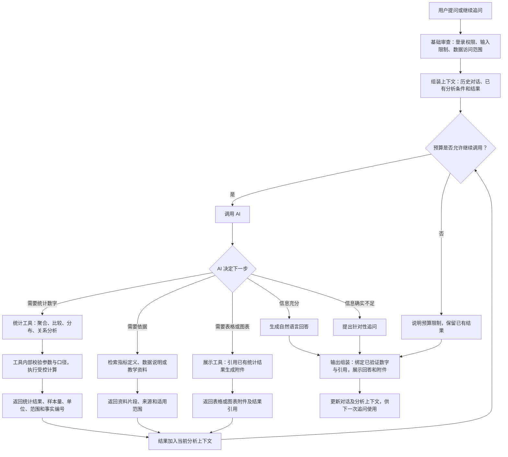

# AI 统一对话与统计分析改进路线图

确认日期：2026-10-19。当前分支：`codex/competition-phase2`。

状态：用户已确认改进方向，本次只记录路线图，尚未实施统一流程。当前第二阶段首版的实现与验证结果仍以[实施记录](competition-phase2.md)为准。

## 1. 改进目标

把“普通问答”和“综合分析”合并成一个对话入口。用户直接提问，AI 根据问题和上下文决定直接回答、查询统计数据、检索资料，或者输出表格和图表。简单问题一轮结束，复杂问题按需要调用工具，不再要求用户先选模式。

职责明确为：AI 理解问题、衔接上下文、选择工具和解释结果；统计工具计算数字；表格和图表展示同一份统计结果；程序只保留必要的访问检查、工具校验、预算与运行兜底。

这次调整替代旧路线中“综合分析独立入口、普通问答保留另一套规划流程”的目标。知识引用、真实执行状态、群体聚合和费用控制继续保留。报告、跨设备会话保存和赛事交付仍按原路线单独安排。

## 2. 目标流程图

说明：工具参数、统计口径和结果校验放在工具内部，不再增加一套独立的“审查模型”。工具失败、取消或超时可以提前结束流程，并如实标记部分结果。表格与图表切换如果只是改变展示方式，前端直接复用结果，不再调用 AI 或重复查询数据库。

## 3. 现有流程要调整什么

| 当前问题 | 调整方向 |
| --- | --- |
| 两种模式分别维护规划、执行和返回逻辑 | 收敛为一个工具循环和一份回复契约 |
| 历史消息打包在单个 JSON 用户消息中，结构化状态主要对应最后一个结果 | 按真实角色传入历史消息，并保留当前任务相关的条件、结果摘要和结果引用 |
| 通用提示词包含“先比较学期，再找下降最多课程”的特定流程 | 移除固定业务步骤；示例只作能力说明，不决定每次执行顺序 |
| 一部分完成判断依赖当前问题中的关键词 | 由 AI 结合目标与实际工具结果判断是否需要继续，不再靠“分布”等关键词充当任务完成判定 |
| 最终回答主要来自模板和知识片段拼接 | AI 基于工具事实组织回答；统计值和来源通过结果引用绑定 |
| 表现为查了定义，却没有回答关系问题 | 将统计关系查询作为可调用能力，明确区分“解释指标”和“检验关系” |

## 4. 统计数据工具与输出约定

### 4.1 统计能力范围

| 能力 | 本轮处理方式 | 返回内容 |
| --- | --- | --- |
| 基础聚合 | 复用现有 DuckDB 聚合能力，统一工具入口 | 指标值、分组、单位、有效样本量和筛选范围 |
| 学期或课程比较 | 复用已有比较计算，去掉对特定任务顺序的依赖 | 对比值、差值、方向、两侧人数和可比性限制 |
| 成绩分布 | 复用已有分档与样本过滤 | 分档人数、占比、有效成绩人数和分档边界 |
| 缺勤、旷课等指标 | 盘点现有数据字段和图表能力，补齐统一的统计查询契约 | 明确区分次数、课时、去重人数及其统计周期；不可互相替代 |
| 关系分析 | 复用现有关系图与聚合计算；缺少的数值摘要按需补齐 | 分组统计或聚合密度、有效配对样本量、缺失处理；有适用实现时才返回相关系数 |

现有基础聚合工具的指标枚举主要是成绩、活动量和完成率；高级图表已有出勤、缺勤等关系维度。这不等于统一统计工具已支持所有这些指标，也不等于已经具备可直接解释的相关系数。实施时先盘点并复用，不把待补能力记为完成。

### 4.2 每份统计结果必须说明的内容

- 结果标识 `resultId`，以及可引用的事实标识 `factId`。
- 数据集与版本、指标、课程、学期、筛选条件和统计粒度。
- 实际计算值、单位、分组标签、有效样本量；比例同时给出分子、分母及各自含义。
- 缺失值处理、最小样本过滤、跨学期重复计次和其他必要限制。
- 可供表格和图表复用的聚合数据；不向模型返回学生名单或个人记录。

字段名可以结合现有类型调整，优先扩展现有结果和附件契约，不另建重复的数据体系。结果标识只能引用当前用户有权访问且版本、筛选范围匹配的结果，不能成为绕过权限的入口。

### 4.3 “缺勤与成绩有关吗”的处理要求

1. 从当前问题和历史对话确定缺勤指标、课程和学期。范围已明确时直接继承；用户明确改变范围时覆盖旧条件。无法判断“人数还是次数”且会改变结论时，只追问这个关键点。
2. 查询当前数据源是否真的有对应字段。缺勤包含请假与旷课，不能用旷课代替全部缺勤，也不能用学习活动代替缺勤。
3. 在数据库内部对齐同一统计单位，例如同一学生、课程、学期的缺勤记录和成绩，先处理重复与缺失，避免关联表放大样本。
4. 返回符合最小样本要求的分组或密度统计，以及适用的关系摘要。个人配对记录留在受控计算内部；不将个人散点行发给模型。
5. AI 回答观察到的关系、样本范围和局限；没有相关系数时不编造相关系数，仅有分组差异时不冒充个体相关，更不能把相关解释成因果。

OULAD 不含校园缺勤字段，应说明无法进行该项计算。若用户同意，可以另查活动量与成绩，但不能默认替换指标。

## 5. 回答、上下文与预算

### 自然回答和数字绑定

- 最终使用 AI 基于实际结果写出的解释，不再用统一的“已完成以下分析”模板替代正常回答。
- 涉及本次统计结论的数字，采用对 `factId` 的结构化引用，由输出层填入对应值、单位和范围；表格、图表也引用同一 `resultId`。
- 基础检查只验证引用存在、结果归属和必要字段，不声称仅靠数字匹配就能证明整段解释正确。结论是否越过统计口径，仍需通过评测验收。
- 输出引用无效时，先展示有效事实并说明解释未完成；需要模型修正时仍占用同一请求的预算和轮次，不无限重试。不把模板作为所有成功回答的默认出口。
- 无数据、缺字段、知识依据不足、用户取消或预算耗尽时分别说明，不套用“请提供前后两个学期”的通用追问。

### 连续对话

- 采用正常的用户、助手消息角色；同一请求内保留完整的工具调用与回传关系，跨轮保留相关结果摘要和受控结果引用。
- 维护已确认的课程、学期、指标、比较方向和未完成问题；允许一次回答涉及多个结果。
- “只看上学期”“换成表格”“那缺勤人数呢”优先结合已有任务解释；明确清空筛选或新对话时清除对应状态。
- 长历史按上下文预算裁剪或摘要，保留关键条件和事实来源；不能因摘要丢失指代就默默猜测。切换数据集时清除不适用的结果引用。
- 本轮解决当前会话内的上下文连续性；刷新恢复、数据库持久化和跨设备同步另行实施。

### 费用与运行兜底

- 每次实际模型调用前检查预算，按实际返回 usage 结算；整次提问共享费用上限，失败调用也记录已产生的用量。
- 同一用户请求关联各轮模型调用，分别记录输入、输出、缓存用量（提供方返回时）、估算标记、配置单价和总费用，避免只靠时间窗口拼出成本。
- 简单问题允许一次调用直接结束；复杂问题按需使用工具，不固定调用次数，也不为已具备的结果重复检索或查询。
- 保留总时间、调用上限、取消和重复调用兜底；不把这些限制做成用户必须选择的工作模式。
- 初期保留现有可用协议适配器与配置绑定的兼容性检查；不支持工具调用时明确说明，不能假装完成数据查询，也不同时维护另一套旧规划器。
- 管理页沿用模型连接、单价、预算等设置，将“综合分析设置”收敛为统一对话的必要限制；不增加一套复杂的流程配置界面。

## 6. 实施顺序与完成标准

| 阶段 | 主要工作 | 完成标准 |
| --- | --- | --- |
| 1. 统一入口和上下文 | 收敛 API 执行入口；按角色传历史；保留相关结果与条件；移除特定比较流程提示 | 同一入口可以直接回答、查询数据和连续追问；不再依赖模式选择或关键词派发 |
| 2. 接好统计与展示 | 盘点统计能力，统一结果引用，补齐缺勤和关系分析的必要统计契约；表格、图表共用结果 | 数字可由原始数据复算；查询与展示范围一致；展示切换不重复查数 |
| 3. 输出自然回答并精简界面 | 接入 AI 最终解释与事实引用；移除模式切换；“数字从哪来”默认折叠；输入区可收起并保留草稿 | 回答能解释本次结果；折叠不会丢失草稿、条件、消息或附件，展开入口始终可用 |
| 4. 回归、用量与本地验收 | 关联请求级 token/费用，运行重点回归和真实模型、多轮浏览器验证 | 有可追溯的成功与失败记录、数值核对和实际调用成本；完成后再更新实施状态 |

前 3 步共同形成可验收版本，再经过第 4 步验证；不能只去掉模式按钮就宣称流程合并完成。保留现有执行状态和附件布局，只显示真实发生的步骤。

主要改动位置：

- `components/workspace.tsx`、`components/ai-conversation.tsx`、`components/ai-conversation.module.css`：统一入口、消息与展示状态、折叠交互。
- `app/api/chat/route.ts`、`lib/ai/conversation.ts`、`lib/ai/comprehensive.ts`：收敛请求执行流程，删除被替代的旧分支。
- `lib/ai/tool-provider.ts`、`lib/ai/chat-types.ts`、`lib/ai/chat-stream.ts`：模型消息、结果与事实引用、流式事件和请求关联。
- `lib/ai/chart-tools.ts`、`lib/analysis/`：统计口径、关系分析、结果复用和展示工具。
- 现有设置、费用记录和相关测试：迁移配置并保持预算、权限和取消语义一致。

## 7. 验收场景

| 场景 | 应观察到的行为 |
| --- | --- |
| 普通交流、已有上下文足够的问题 | 可以直接回答，不强制查统计数据或知识库 |
| “各科成绩分布如何？”→“只看2025J”→“换成表格” | 正确继承指标与课程，更新学期；最后一步复用同一统计结果 |
| “缺勤次数和成绩有关系吗？”→“那缺勤人数呢？” | 回答基于实际统计；区分次数与人数，承接成绩和范围，必要时只澄清有歧义的指标 |
| 比较两学期后分析下降最多课程的分布 | 依据真实比较结果选课；无下降时说明情况；不把此任务顺序套到其他问题 |
| 单学期、全部学期、缺失值、小样本 | 范围、单位、分母和人数正确；隐藏不当作零，缺失成绩不当作零分 |
| OULAD 缺勤问题、未收录的学校收费规则 | 如实说明缺字段或缺依据，不虚构数值或擅自替换指标 |
| 结果引用无效、表格与图表切换 | 无效引用不能输出为事实；有效展示一致，不重复查询和重复计费 |
| 预算不足、循环调用、超时、用户停止 | 有明确终止条件；保留有效结果；不把部分完成标为全部成功；晚到结果不覆盖新消息 |
| 未授权访问、要求个人名单或任意 SQL | 基础权限和工具边界继续生效 |
| 新对话、切换数据集、收起输入区 | 新旧分析条件不串用；草稿和折叠状态符合界面约定 |

验证分三层记录：受控测试验证协议与边界；独立 CSV/数据库复算验证统计；真实模型和浏览器验证理解、连续追问与展示。模拟回放不能代替真实模型验收。

成本比较使用相同模型、单价、数据集和一组固定任务，对照当前版本记录每题模型调用次数、输入/输出 token、费用、耗时和是否完成目标。简单问答、多步分析和展示切换分别比较；费用降低不能以回答错误或丢失上下文为代价，不预先承诺节省比例。

现有真实回归记录仍有 6 项未通过，见[第二阶段实施记录](competition-phase2.md#既有真实评测的未通过项)。实施后逐项复核并分别记录代码、数据夹具和期望定义问题，不修改断言来掩盖失败。本路线图的写入不代表这些问题已解决。
